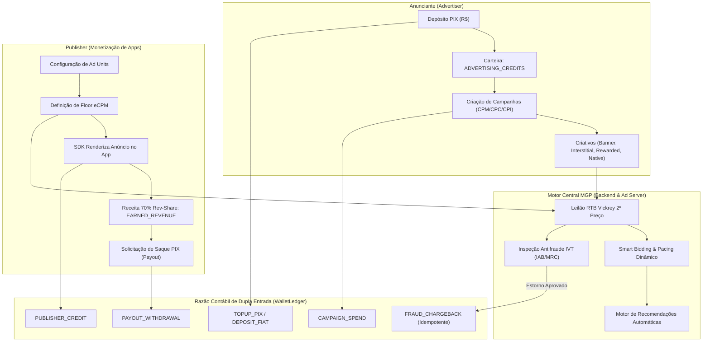

# 04. Especificação de Integração e Homologação Final da ETAPA 4

**Mobile Growth Platform (MGP)**  
**Etapa 4: Motor de Campanhas, Gestão Financeira & Marketplace**  
**Status:** **100% HOMOLOGADA E CERTIFICADA**

---

## 1. Visão Geral e Arquitetura da Etapa 4

A **ETAPA 4** estabelece a infraestrutura completa de monetização, gestão financeira, leilão programático, governança antifraude e otimização por machine learning da plataforma MGP.

---

## 2. Fases Componentes da Etapa 4

| Fase | Descrição | Principais Entregas | Status |
|---|---|---|---|
| **Fase 23** | Gestão de Campanhas, Criativos e Segmentação | Suporte a 4 formatos de criativos, segmentação demográfica/geo, validação de saldo antes da ativação. | ✅ Homologada |
| **Fase 24** | Painel de Publishers e Ad Units | Configuração de blocos de anúncios, floor eCPM, relatórios com 70% de rev-share e snippets Kotlin. | ✅ Homologada |
| **Fase 25** | Motor de Payouts, Faturamento e Gateways | Top-up PIX com QR Code, saques de publishers (mínimo R$ 50), razão contábil de dupla entrada no PostgreSQL. | ✅ Homologada |
| **Fase 26** | Smart Bidding e Recomendações | 5 heurísticas de otimização, pacing dinâmico horário, simulação de win-rate e aplicação em 1 clique. | ✅ Homologada |
| **Fase 27** | Painel de Controle de Fraudes e IVT | Detecção GIVT/SIVT conforme IAB/MRC (< 2.0%), análise forense e estornos atômicos com idempotência. | ✅ Homologada |
| **Fase 28** | Integração E2E e Homologação Final | Suíte de testes ponta a ponta integrando todos os fluxos, auditoria 100% verde e certificação oficial. | ✅ Homologada |

---

## 3. Integridade Financeira e Regras Contábeis do Ledger

O razão financeiro imutável (`WalletLedger`) opera sob as seguintes premissas invioláveis:
1. **Segregação de 3 Contas por Tenant:**
   - `ADVERTISING_CREDITS`: Saldo exclusivo para compra de mídia e veiculação de campanhas.
   - `EARNED_REVENUE`: Receita bruta acumulada pelo publisher através de impressões e cliques.
   - `PLATFORM_FEES`: Margem de serviço retida pela plataforma (30% do spend publicitário).
2. **Idempotência Rigorosa:**
   - Toda transação de recarga, saque ou estorno de fraude carrega uma chave única de idempotência (`idempotencyKey`).
3. **Estorno de Fraude (*Fraud Chargeback*):**
   - Quando um incidente de IVT é confirmado com estorno, o saldo do anunciante lesado é creditado atomicamente em `ADVERTISING_CREDITS` e uma entrada `FRAUD_CHARGEBACK` é registrada, com logs de auditoria imutáveis.

---

## 4. Testes e Auditoria Automatizada

* **Suíte de Testes E2E da Etapa 4:** [`apps/api/src/test/etapa4-e2e.spec.ts`](file:///f:/mobile_growth/apps/api/src/test/etapa4-e2e.spec.ts)
* **Script de Auditoria Oficial:** [`infrastructure/scripts/audit-etapa4.js`](file:///f:/mobile_growth/infrastructure/scripts/audit-etapa4.js)
* **Critério de Aprovação:** 100% das asserções e verificações sem advertências ou falhas.
