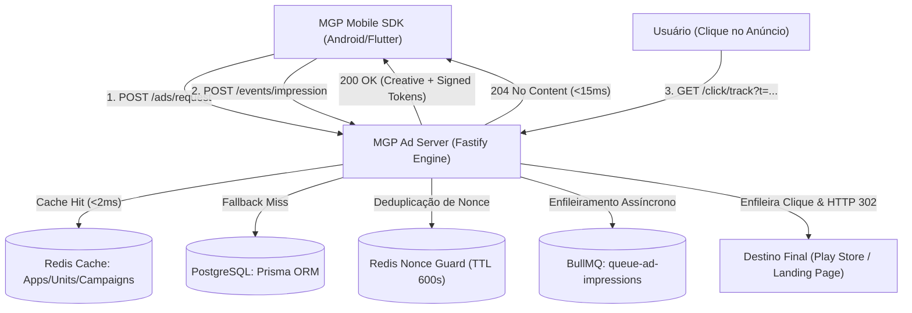

# MGP Ad Server — Arquitetura de Ultra-Baixa Latência e Especificação (Fase 20)

Este documento descreve a especificação técnica e a arquitetura do motor de anúncios (**Ad Server**) da Mobile Growth Platform (MGP), desenvolvido sob a engine Fastify para atendimento de alto throughput e latência estrita (< 50ms).

---

## 1. Visão Geral da Arquitetura

O Ad Server opera como um microsserviço independente e de alta escalabilidade, desacoplado do Core API de gestão:

---

## 2. Padrões de Alta Performance do Fastify

Para alcançar throughput massivo com baixa utilização de CPU/memória:
- **Fastify Framework:** Utilização de instâncias nativas do Fastify em substituição ao Express, reduzindo o overhead por requisição em mais de 70%.
- **Camada de Cache Estratificado:** Dados quentes de aplicativos, blocos de anúncios (`AdUnit`) e campanhas ativas são armazenados no Redis com TTLs curtos (60s a 300s).
- **Fallbacks Defensivos:** Em caso de oscilação do Redis, o Ad Server degrada graciosamente para cache em memória (LRU Map) e deduplicação de nonces local.
- **Pino Structured Logger:** Logs estruturados em formato JSON com campos serializados otimizados para pipelines de observabilidade.
- **CORS e Rate Limiting:** Proteção ativa contra DoS e abuso com limites de até 500 req/min por IP.

---

## 3. Protocolo de Solicitação de Anúncios (`POST /ads/request`)

### 3.1 Cabeçalhos e Autenticação
- `X-MGP-SDK-Key`: Chave pública do SDK móvel para autenticação do publisher.
- `X-MGP-App-ID`: Identificador único do aplicativo (UUID).
- `Content-Type`: `application/json`.

### 3.2 Validação do Inventário e Multi-Tenancy
1. O Ad Server resolve o aplicativo pela SDK Key e verifica se está ativo (`isActive: true`).
2. Valida o bloco de anúncios (`AdUnit`):
   - Verifica se pertence ao aplicativo autenticado (`adUnit.appId === app.id`).
   - Verifica se o formato solicitado é compatível com o bloco (`BANNER`, `NATIVE`, `INTERSTITIAL`, `REWARDED`).
   - Recupera o preço de reserva configurado (`floorEcpm`).
3. Busca campanhas ativas no país de destino com criativos no formato especificado.
4. Aplica filtro de auto-impressão: anunciantes não concorrem em leilão pago em seus próprios inventários (exceto se a campanha for do tipo `HOUSE_AD`).
5. Ordenação e desempate:
   - Prioridade 1: **PAID** (ordenado pelo maior `bidAmount` que supere o `floorEcpm`).
   - Prioridade 2: **EXCHANGE** (troca de impressões da rede).
   - Prioridade 3: **HOUSE_AD** (anúncio próprio de fallback).

---

## 4. Segurança Criptográfica e Prevenção Anti-Replay

### 4.1 Assinatura Criptográfica de Tokens (`TokenService`)
Todos os eventos subsequentes (impressão e clique) dependem de tokens emitidos pelo Ad Server:
$$\text{Token} = \text{Base64Url}(\text{Payload JSON}) \mathbin{\Vert} \text{"."} \mathbin{\Vert} \text{HMAC-SHA256}(\text{Base64Url}, \text{Secret})$$

O payload contém:
- `requestId`, `adUnitId`, `campaignId`, `creativeId`.
- `publisherAppId`, `publisherOrgId`, `advertiserOrgId`.
- `bidAmount`, `billingModel`, `format`, `actionUrl`.
- `issuedAt`, `expiresAt` (TTL de 900 segundos).

A validação utiliza `crypto.timingSafeEqual` para imunidade estrita a ataques de canal lateral baseados em tempo (*timing attacks*).

### 4.2 Deduplicação Atômica de Nonce
Tanto para `/events/impression` quanto para `/events/click`, o cliente envia um `nonce` (UUID v4):
- O Ad Server executa `SET nonce:adserver:{nonce} 1 EX 600 NX` no Redis.
- Se o comando retornar nulo (chave já existente), o evento é imediatamente rejeitado com status `409 Conflict` e código `NONCE_ALREADY_USED`.

---

## 5. Endpoints REST Implementados

| Método | Endpoint | Função | Resposta |
|---|---|---|:---:|
| `GET` | `/health` | Liveness, readiness, métricas de memória e estado da conexão Redis. | `200 OK` |
| `POST` | `/ads/request` | Processamento de requisições de anúncios, seleção de criativos e emissão de tokens. | `200 OK` |
| `POST` | `/events/impression` | Telemetria de impressão renderizada com validação de token e deduplicação de nonce. | `204 No Content` |
| `POST` | `/events/click` | Telemetria direta de clique reportada pelo SDK. | `204 No Content` |
| `GET` | `/click/track` | Rastreamento intermediário com redirecionamento HTTP 302 para `actionUrl`. | `302 Found` |
| `GET` | `/metrics` | Métricas operacionais em tempo real (total de requisições, fill rate, eventos enfileirados). | `200 OK` |

---

## 6. Filas Assíncronas (BullMQ)

Eventos recebidos com sucesso são despachados sem bloqueio para as filas:
- `queue-ad-impressions`: Fila de impressões verificadas para conciliação contábil e faturamento.
- `queue-ad-clicks`: Fila de cliques verificados para atribuição de tráfego e relatórios analíticos.
