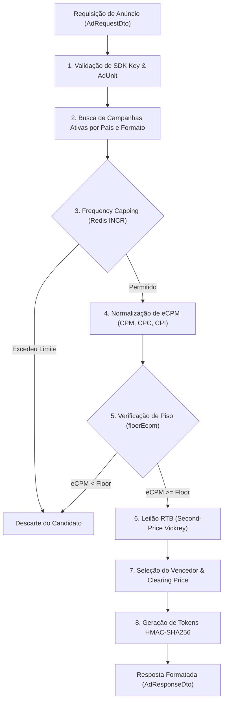

# MGP Ad Server — Motor de Decisão, Leilão RTB e Entrega de Formatos (Fase 21)

Este documento especifica o motor de leilão em tempo real (**RTB - Real-Time Bidding**) e os protocolos de entrega dos quatro formatos publicitários oficiais suportados pelo ecossistema MGP: **Banner, Nativo, Interstitial e Premiado (Rewarded)**.

---

## 1. Visão Geral do Motor de Leilão e Decisão

O `AdDecisionService` executa a seleção do criativo vencedor em menos de **25 milissegundos**, operando sob uma arquitetura de leilão competitivo com cálculo dinâmico de eCPM e controle de saturação (Frequency Capping):



---

## 2. Modelos de Precificação e Normalização de eCPM

Para permitir a concorrência justa entre anunciantes que compram por diferentes modelos de faturamento, o Ad Server normaliza todos os lances para **eCPM (efetivo por mil impressões)** antes do leilão:

| Modelo de Faturamento | Fórmula de Conversão de eCPM | Premissa Heurística Padrão |
|---|---|---|
| **CPM** (Custo por Mil Impressões) | $\text{eCPM} = \text{bidAmount}$ | Preço direto de reserva por 1.000 impressões. |
| **CPC** (Custo por Clique) | $\text{eCPM} = \text{bidAmount} \times \text{predictedCTR} \times 1000$ | CTR preditivo de **2.0%** (0.02) $\rightarrow \text{eCPM} = \text{bid} \times 20$. |
| **CPI** (Custo por Instalação) | $\text{eCPM} = \text{bidAmount} \times \text{predictedCTR} \times \text{predictedCVR} \times 1000$ | CVR de **10%** sobre cliques $\rightarrow \text{eCPM} = \text{bid} \times 2$. |

---

## 3. Leilão de Segundo Preço (Second-Price Vickrey Auction com Floor)

O Ad Server adota o modelo de leilão de segundo preço com preço de reserva (*Floor eCPM*):
1. **Ordenação:** Os candidatos são agrupados por nível de prioridade (*Tier*) e ordenados por eCPM decrescente.
2. **Vencedor:** O candidato com o maior eCPM no tier prioritário.
3. **Preço de Liquidação (*Clearing Price*):**
   - Caso haja um segundo colocado no mesmo tier:
     $$\text{clearingPrice} = \min\left(\text{winner.eCPM}, \max(\text{second.eCPM} + \$0.01, \text{floorEcpm})\right)$$
   - Caso seja o único concorrente elegível:
     $$\text{clearingPrice} = \text{floorEcpm}$$

O `clearingPrice` é registrado no payload criptográfico do token e na resposta JSON do leilão em `pricing.clearingPrice`.

---

## 4. Limitação de Frequência (Frequency Capping)

Para prevenir fadiga do usuário e cliques acidentais:
- Cada campanha pode definir `frequencyCapPerHour` (padrão: 3 a 5 exibições por hora).
- Quando o SDK informa o `advertisingId` (AAID):
  - O Ad Server executa `INCR freq:{campaignId}:{advertisingId}` no Redis com TTL de 3.600 segundos.
  - Se o contador superar o limite configurado, a campanha é descartada para aquele usuário durante o restante da janela temporal.

---

## 5. Especificação dos Quatro Formatos Publicitários

### 5.1 Banner (`BANNER`)
- **Propósito:** Anúncio display retangular renderizado em contêineres fixos (topo ou rodapé).
- **Dimensões Suportadas:** 320x50 (Standard Banner), 300x250 (Medium Rectangle).
- **Campos Específicos:** `width`, `height`, `imageUrl`, `actionUrl`.

### 5.2 Nativo (`NATIVE`)
- **Propósito:** Anúncio modular estilizado de acordo com o design nativo do app publisher.
- **Campos Específicos:**
  - `iconUrl`: Ícone do aplicativo anunciado (1:1).
  - `ctaText`: Texto de chamada para ação (ex: "Instalar", "Jogar Agora", "Abrir").
  - `starRating`: Nota do app na loja (0.0 a 5.0).
  - `sponsorText`: Identificação do anunciante / tag "Patrocinado".

### 5.3 Interstitial (`INTERSTITIAL`)
- **Propósito:** Anúncio visual ou em vídeo em tela cheia exibido em pausas naturais de fluxo (ex: transição de telas ou fim de fase).
- **Dimensões:** Tela cheia (1080x1920 adaptável).
- **Campos Específicos:**
  - `skipOffsetSeconds`: Tempo mínimo obrigatório antes de exibir o botão de fechar (padrão: 5 segundos).
  - `htmlContent`: Código HTML/Rich Media opcional para anúncios interativos.

### 5.4 Premiado (`REWARDED`)
- **Propósito:** Anúncio com recompensa voluntária onde o usuário aceita assistir ao vídeo completo em troca de um benefício no app (moedas, vidas extras).
- **Campos Específicos:**
  - `rewardType`: Identificador da recompensa (ex: `GOLD_COINS`, `LIVES`, `GEMS`).
  - `rewardAmount`: Quantidade inteira da recompensa (ex: 50).
  - `requiredWatchSeconds`: Duração mínima obrigatória para validação da recompensa (padrão: 15 segundos).
  - `rewardToken`: Token assinado com HMAC-SHA256 gerado pelo servidor para resgate no endpoint `/events/reward`.

---

## 6. Protocolo de Validação de Recompensa (`POST /events/reward`)

Para prevenir fraudes e resgates antecipados de recompensas:
1. O cliente submete o `rewardToken`, um `nonce` único, `completedAt` e `watchDurationSeconds`.
2. O servidor valida a integridade criptográfica do `rewardToken` e a expiração.
3. O servidor verifica se $\text{watchDurationSeconds} \ge \text{requiredWatchSeconds}$. Caso o usuário tenha pulado ou fechado o vídeo antecipadamente, a requisição é rejeitada com código `400` e motivo `INSUFFICIENT_WATCH_DURATION`.
4. O `nonce` é deduplicado atomicamente no Redis para evitar que o mesmo token de recompensa seja resgatado múltiplas vezes (`409 NONCE_ALREADY_USED`).
5. O evento é enfileirado na fila BullMQ `queue-ad-rewards` para consolidação e a API retorna confirmação estruturada:
   ```json
   {
     "success": true,
     "verified": true,
     "rewardType": "GOLD_COINS",
     "rewardAmount": 50
   }
   ```

