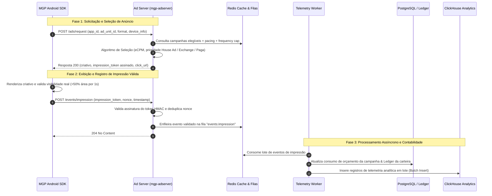

# 01. Arquitetura Geral do Sistema (MGP)

## 1. Visão Arquitetural

A **Mobile Growth Platform (MGP)** é concebida como uma plataforma SaaS modular de alta performance, preparada para atender simultaneamente a dois perfis operacionais com padrões de carga totalmente distintos:

1. **Plataforma SaaS de Gestão & Inteligência (Baixa concorrência / Alta complexidade de consulta):**
   * Painel de controle para Publishers, Anunciantes e Analistas de ASO.
   * Catálogo de aplicativos, monitoramento de palavras-chave, tendências da Google Play Store, métricas financeiras e gestão de campanhas.
   * Carga típica de requisições com queries relacionais, relatórios analíticos e processamentos assíncronos.

2. **Ad Network & Ad Server (Altíssima concorrência / Baixa latência < 80ms):**
   * Ponto de contato direto com os aplicativos móveis que integram o SDK.
   * Leilão em tempo real, seleção de criativos, controle de pacing, frequency capping e ingestão massiva de telemetria (impressões e cliques).
   * Operação desacoplada baseada em memória (Redis) para tomada de decisão imediata, sem concorrência direta com as transações do banco relacional.

---

## 2. Diagrama de Topologia Geral

```mermaid
flowchart TD
    subgraph CLIENTS["Clientes & Dispositivos"]
        SDK["Apps com SDK MGP (Android / Flutter)"]
        BROWSER_PUB["Dashboard Web (Next.js)"]
        BROWSER_ADM["Admin Backoffice (Next.js)"]
    end

    subgraph INGRESS["Camada de Entrada & Roteamento"]
        GATEWAY["Reverse Proxy / EasyPanel / SSL"]
    end

    subgraph APPS["Serviços de Aplicação"]
        AD_SERVER["mgp-adserver (Node.js/Fastify/Nest)"]
        CORE_API["mgp-api (NestJS Core REST)"]
        WORKERS["mgp-workers (BullMQ Processors)"]
        WEB_APP["mgp-web (Next.js SSR/App Router)"]
        ADMIN_APP["mgp-admin (Next.js Backoffice)"]
    end

    subgraph STORAGE["Camada de Persistência & Mensageria"]
        REDIS[("Redis 7.x (Cache, Filas, Pacing, Tokens)")]
        POSTGRES[("PostgreSQL 16 (Dados Transacionais & Ledger)")]
        CLICKHOUSE[("ClickHouse (Telemetria & Eventos Analíticos)")]
        OBJ_STORAGE[("Object Storage (Imagens, Banners, APKs)")]
    end

    SDK -->|"HTTPS (Ad Request / Events)"| GATEWAY
    BROWSER_PUB -->|"HTTPS (Dashboard)"| GATEWAY
    BROWSER_ADM -->|"HTTPS (Admin)"| GATEWAY

    GATEWAY -->|"/ads/* e /events/*"| AD_SERVER
    GATEWAY -->|"/api/v1/*"| CORE_API
    GATEWAY -->|"app.mgp.com.br"| WEB_APP
    GATEWAY -->|"admin.mgp.com.br"| ADMIN_APP

    AD_SERVER -->|"Consulta regras / Cache"| REDIS
    AD_SERVER -->|"Enfileira eventos"| REDIS
    
    CORE_API -->|"CRUD / Autenticação / Ledger"| POSTGRES
    CORE_API -->|"Cache / Rate limit"| REDIS
    CORE_API -->|"Leitura de Métricas"| CLICKHOUSE

    WORKERS -->|"Consome tarefas"| REDIS
    WORKERS -->|"Sincroniza agregações"| POSTGRES
    WORKERS -->|"Ingestão em lote"| CLICKHOUSE
    WORKERS -->|"Download & Upload"| OBJ_STORAGE
```

---

## 3. Ciclo de Vida da Publicidade (Ad Lifecycle & Decision Engine)

Para evitar gargalos de banco relacional e garantir latência média de resposta inferior a **80ms**, o fluxo publicitário foi desenhado com desacoplamento rigoroso:

---

## 4. Diretrizes de Desacoplamento dos Domínios

1. **Inteligência de Mercado (ASO) Independente:**
   * O módulo de ASO consome dados de ranking e palavras-chave através de workers especializados de coleta.
   * Nenhuma falha de serviço externo ou bloqueio de scraping afeta a disponibilidade do Ad Server ou do painel transacional.

2. **Isolamento do Motor de Leilão:**
   * O `mgp-adserver` é stateless e não executa transações pesadas em banco relacional no momento da requisição. Toda a informação necessária para a decisão (segmentação, orçamento ativo e regras de troca) reside em estruturas otimizadas no **Redis**.

3. **Separação entre Transações e Métricas:**
   * Tabelas do PostgreSQL armazenam exclusivamente registros estruturados de negócio (usuários, campanhas, regras e lançamentos contábeis).
   * Bilhões de impressões e cliques brutos são canalizados via filas e consolidados no **ClickHouse** (ou tabelas de agregações horárias/diárias em estágio inicial).

