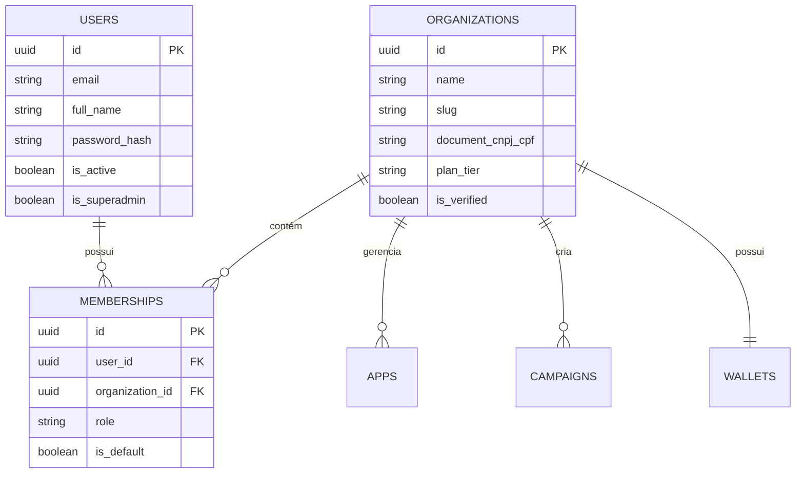

# 04. Estratégia Multi-Tenant e Controle de Acesso (RBAC)

## 1. Arquitetura Multi-Tenant

Para a **Mobile Growth Platform (MGP)**, adotou-se o modelo de **Banco Compartilhado com Discriminação Lógica por Tenant** (`organization_id`).

### Justificativa da Escolha:
1. **Eficiência de Recursos:** Permite escalabilidade sem criar sobrecarga de centenas de schemas PostgreSQL ou bancos isolados em um servidor VPS inicial.
2. **Consultas Agregadas de Inteligência:** Facilita queries anônimas e agregadas de mercado no ASO Studio sem necessidade de migrações complexas entre bancos.
3. **Migrações Unificadas:** Uma única execução de migration atualiza toda a base simultaneamente sem divergência de schemas entre clientes.

---

## 2. Modelo de Isolamento e Relação Usuário-Organização

Um usuário pode pertencer a múltiplas organizações (ex: uma software house com divisões ou consultorias atendendo múltiplos estúdios).



---

## 3. Matriz de Papéis e Permissões (RBAC)

Cada organização define permissões granulares atribuídas através de papéis (`roles`):

| Papel | Descrição | Permissões Principais |
| :--- | :--- | :--- |
| **OWNER** | Proprietário da organização | Controle total: exclusão da conta, transferência de posse, alteração de plano de assinatura, gestão financeira e saques. |
| **ADMIN** | Administrador de equipe | Adicionar/remover membros, gerenciar todas as campanhas, cadastrar apps, visualizar faturamento. Não pode transferir posse da organização. |
| **MANAGER** | Gestor de operações | Criação e edição de campanhas, orçamentos, criativos e blocos de anúncios (Ad Units). Sem acesso a dados bancários ou exclusão de apps. |
| **ANALYST** | Analista de Inteligência | Consulta ao ASO Studio, relatórios de palavras-chave, análise competitiva e telemetria analítica (somente leitura). |
| **DEVELOPER**| Engenheiro de Software | Visualização e geração de SDK Keys, configuração de Ad Units, endpoints de teste e relatórios de integração. |
| **PUBLISHER**| Foco em monetização | Visualização exclusiva de métricas de blocos de anúncios, fill rate, impressões entregues e ganhos gerados. |
| **ADVERTISER**| Foco em aquisição | Visualização exclusiva de campanhas de tráfego, criativos, CTR, conversões e consumo de orçamento. |

---

## 4. Garantia de Isolamento no Código (Zero Data Leakage)

Para impossibilitar o vazamento de dados entre organizações diferentes:

### 4.1. Extração de Contexto por `TenantInterceptor`
Toda requisição autenticada tem o cabeçalho `X-Organization-Id` validado contra a tabela de membresias do usuário logado:
```typescript
// Pseudocódigo do guardião no NestJS
const membership = await prisma.membership.findFirst({
  where: {
    userId: request.user.id,
    organizationId: request.headers['x-organization-id'],
  },
});
if (!membership) {
  throw new ForbiddenException('Acesso negado à organização informada.');
}
request.tenant = { organizationId: membership.organizationId, role: membership.role };
```

### 4.2. Escopo Obrigatório nas Consultas Prisma
Nenhuma consulta a entidades privadas (`apps`, `campaigns`, `ad_units`, `wallets`) pode ser executada sem filtrar explicitamente pelo `organization_id` do tenant autenticado:
```typescript
// Padrão obrigatório nos Repositories
async findAppById(appId: string, organizationId: string) {
  return this.prisma.app.findFirst({
    where: {
      id: appId,
      organizationId: organizationId, // Isolamento mandatória
    },
  });
}
```

### 4.3. Testes Automatizados de Isolamento
Na **Fase 05 e Fase 10**, serão obrigatórios testes de integração cruzados verificando que o Usuário A (Org 1) recebe status `404 Not Found` ou `403 Forbidden` ao tentar ler, atualizar ou excluir recursos da Org 2.

