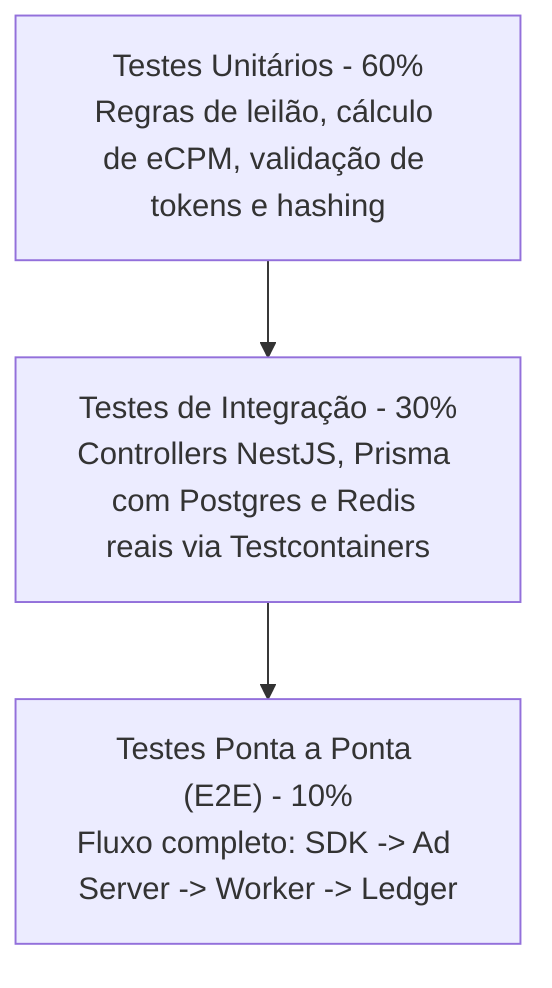

# 09. Critérios de Qualidade, Testes e Aprovação por Fase

## 1. Princípio da Imutabilidade e Governança

Para garantir a confiabilidade na construção da **Mobile Growth Platform (MGP)**, o processo de engenharia adota a regra: **Nenhum código de fases posteriores pode ser iniciado sem que a fase corrente satisfaça 100% de seus critérios de aceite e passe por auditoria técnica formal.**

---

## 2. Estratégia da Pirâmide de Testes

### 2.1. Testes Unitários (Jest / Vitest)
* Cobertura mínima de **80% de linhas e branches** no módulo financeiro (`WalletModule`), regras do Ad Server e validação de tokens.
* Execução em menos de 10 segundos no ambiente local.

### 2.2. Testes de Integração
* Execução contra instâncias reais de PostgreSQL e Redis (utilizando Docker local ou Testcontainers).
* Testes obrigatórios de isolamento de tenant: garantir que queries com filtros incorretos falhem imediatamente sem retornar dados de outras organizações.

### 2.3. Análise Estática de Código
* TypeScript com modo estrito (`"strict": true`, `"noImplicitAny": true`).
* ESLint e Prettier integrados sem alertas ou exceções ignoradas no commit.

---

## 3. Definition of Done (DoD) por Fase

Para que qualquer uma das 10 fases da Etapa 1 seja considerada concluída, ela deve entregar:

1. **Código Versionado:** Commit e push realizados na branch de feature correspondente seguindo o padrão Conventional Commits.
2. **Build Limpo:** `pnpm build` executado sem erros ou avisos de tipagem em todas as aplicações e pacotes.
3. **Pipeline de Testes Verde:** `pnpm test` e `pnpm test:e2e` executando com 100% de sucesso.
4. **Zero Código Morto / Fictício:** Nenhuma interface ou tela com botões "decorativos" sem manipulador real de eventos.
5. **Documentação Atualizada:** Atualização de schemas, rotas e instruções de execução na pasta `docs/`.
6. **Relatório Técnico de Entrega:** Registro descritivo das entregas, riscos mitigados e evidências de testes para auditoria.

---

## 4. Checklist de Aprovação para Transição de Fase

Antes de autorizar o início da próxima fase (ex: da Fase 01 para a Fase 02), o seguinte checklist deve ser validado:

- [ ] **Documentação:** Todos os entregáveis documentais da fase foram gerados e revisados.
- [ ] **Coerência Arquitetural:** Não existem contradições entre contratos de API, schemas de banco e fluxos de negócio.
- [ ] **Segurança e Privacidade:** Nenhum segredo ou chave estática gravada em repositório; aderência a políticas de privacidade comprovada.
- [ ] **Aceite do Gerente Técnico:** Parecer formal aprovando o avanço.

