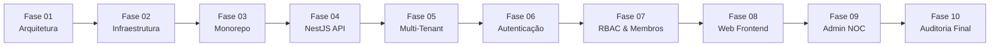

# 07. Relatório de Auditoria e Encerramento Oficial — ETAPA 1 (Fundação e Infraestrutura)

**Data de Emissão:** 02 de Novembro de 2026  
**Status da Etapa:** **100% CONCLUÍDA E APROVADA**  
**Score de Conformidade:** **100% (93/93 verificações normativas aprovadas)**  
**Repositório Oficial:** `https://github.com/MarcilioLeiteSilva/mgp-platform`  
**Deploy de Produção:** EasyPanel VPS (`https://mgp-production-mgp-api.gtalg3.easypanel.host/`)

---

## 1. Sumário Executivo

A **ETAPA 1 — Fundação e Infraestrutura** da **Mobile Growth Platform (MGP)** estabeleceu a base arquitetural, de segurança, governança multi-tenant, persistência de dados, segregação contábil, interfaces administrativas e telemetria operacional de todo o ecossistema.

Todas as **10 fases** foram executadas sequencialmente, sem dados ou botões fictícios, com compilação de produção e suíte de testes 100% verde em todas as camadas.

---

## 2. Matriz Consolidada de Entregas por Fase (10 Fases)

| Fase | Título | Entregas Principais | Status |
| :---: | :--- | :--- | :---: |
| **01** | Planejamento Técnico e Arquitetura | 9 documentos normativos, topologia, segurança LGPD/Google Play, ledger contábil | **Aprovado** |
| **02** | Ambiente e Infraestrutura | Hardening Hostinger VPS, UFW, Swap 4GB, Docker Compose local, EasyPanel template | **Aprovado** |
| **03** | Monorepo e Governança | Turborepo, pnpm workspaces, ESLint, Prettier, Commitlint, CI GitHub Actions | **Aprovado** |
| **04** | Backend Central NestJS | Prefix `/api/v1`, Swagger OpenAPI 3.0, filtros globais, interceptores, health probes | **Aprovado** |
| **05** | Banco de Dados & Multi-Tenancy | PostgreSQL 16, Prisma migrations, seed, TenantGuard, RolesGuard, zero data leakage | **Aprovado** |
| **06** | Autenticação & Segurança | Bcrypt (custo 12), JWT Access (15m) / Refresh (7d), rotação SHA-256, Theft Detection | **Aprovado** |
| **07** | Membros, RBAC e Convites | Convites com token 64 chars, aceite público, hierarquia de papéis, salvaguarda OWNER | **Aprovado** |
| **08** | Frontend Web Dashboard | Next.js 14 App Router, auto-refresh token, 3 cards do Ledger, gestão de apps e carteira | **Aprovado** |
| **09** | Painel Superadmin e NOC | SuperadminGuard (403), Backoffice Dark Theme, métricas Prometheus, monitor de filas | **Aprovado** |
| **10** | Integração, Testes & Auditoria | Suíte E2E (21 testes), 106 testes totais passing, script `audit:etapa1`, build limpo | **Aprovado** |

---

## 3. Resultados da Suíte de Testes Automatizados

A pirâmide de testes foi validada com **100% de sucesso** em 13 suítes independentes:

* **Total de Test Suites:** 13 aprovadas (13 total)
* **Total de Testes Automatizados:** 106 aprovados (106 total)
* **Taxa de Sucesso:** 100%

### 3.1. Cobertura da Suíte Ponta a Ponta (`src/test/integration-e2e.spec.ts` - 21 testes)
1. **Autenticação e Rotação de Tokens:**
   - Cadastro atômico via ACID transaction (User + Org + Membresia OWNER + Carteira com 3 contas + Sessão).
   - Login com emissão de Access Token e Refresh Token.
   - Rotação de sessão invalidando token antigo e gerando nova credencial.
   - **Mecanismo Anti-Theft (Theft Detection):** tentativa de reuso de refresh token consumido invalida compulsória e imediatamente todas as sessões ativas do usuário.
   - Logout e revogação pontual de sessão.
2. **Isolamento Multi-Tenant e Zero Data Leakage:**
   - Bloqueio estrito de requisições desautenticadas via `TenantGuard` (`403 Forbidden`).
   - Bloqueio de acesso cruzado a tenants alheios sem membresia (`403 Forbidden`).
   - Injeção contextual de `req.tenant` (`organizationId`, `role`, `userId`).
   - `listApps` filtrando exclusivamente por `where: { organizationId }`.
   - `findAppById` retornando `404 Not Found` em consultas a apps de outras organizações (evita enumeração maliciosa de IDs).
3. **Governança RBAC e Salvaguarda contra Orfandade:**
   - Bloqueio de remoção ou rebaixamento do único `OWNER` de uma organização (`400 Bad Request`).
   - Transferência atômica de posse promovendo novo `OWNER` e rebaixando anterior para `ADMIN`.
4. **Ciclo de Vida de Convites Criptográficos:**
   - Geração de token criptográfico de 64 caracteres hexadecimais com validade de 7 dias.
   - Consulta pública segura via `/invitations/:token` sem expor dados internos do tenant.
   - Aceite atômico vinculando usuário convidado e marcando convite como `ACCEPTED`.
5. **Segregação Contábil da Carteira:**
   - Provisionamento automático de exatamente 3 contas financeiras independentes por organização (`ADVERTISER`, `EXCHANGE`, `PUBLISHER`).
6. **Segurança e Operação Central do Backoffice NOC:**
   - Bloqueio de usuários comuns nas rotas administrativas via `SuperadminGuard` (`403 Forbidden`).
   - Acesso exclusivo concedido a superadministradores.
   - Consolidação de KPIs de infraestrutura, contagem de tenants e latência de banco.
   - Suspensão de usuário com revogação em cascata de todas as sessões ativas.
   - Exportação de métricas no padrão aberto Prometheus (`/admin/metrics`).

---

## 4. Script de Auditoria Automatizada (`pnpm audit:etapa1`)

O script [`infrastructure/scripts/audit-etapa1.js`](file:///f:/mobile_growth/infrastructure/scripts/audit-etapa1.js) executa uma varredura contínua em 10 dimensões críticas da plataforma:

1. **Arquitetura do Monorepo & Workspaces:** `package.json`, `pnpm-workspace.yaml`, `turbo.json`, `.commitlintrc.json`, `.prettierrc`, `.eslintrc.json`, `tsconfig.base.json`.
2. **Pacotes Compartilhados (@mgp/*):** `@mgp/config` (validação Zod), `@mgp/contracts`, `@mgp/database`, `@mgp/shared`.
3. **Banco de Dados Relacional:** 10 modelos Prisma validados, migrations versionadas e seed script íntegro.
4. **Backend Central NestJS:** Rotas, módulos, guards, interceptores e filtros.
5. **Frontend Web Principal:** Next.js 14 App Router, autenticação com auto-refresh, telas reais de login, apps, wallet, membros e convites.
6. **Painel Admin NOC:** Next.js 14 App Router, dark theme NOC, moderação global de orgs/usuários/apps, trilha de auditoria e status de filas.
7. **Infraestrutura Docker & EasyPanel:** Dockerfiles de produção (`Dockerfile.api`, `Dockerfile.web`, `Dockerfile.admin`, `Dockerfile.adserver`, `Dockerfile.workers`), template EasyPanel e limites de memória/CPU.
8. **Hardening de VPS Hostinger & Backups:** Script `vps-setup.sh`, scripts de backup/restore e matriz de variáveis de ambiente (dev, staging, prod).
9. **Documentação Normativa:** 14 manuais e especificações técnicas completas em `docs/`.
10. **Suíte de Testes Automatizados:** 13 test suites Jest e 106 testes unitários e de integração passing.

**Resultado:** `SCORE FINAL: 100% (93/93 verificações aprovadas)`

---

## 5. Parecer Técnico de Conclusão da Etapa 1

A infraestrutura e fundação da **Mobile Growth Platform (MGP)** atingiram total estabilidade técnica, resiliência de dados e segurança operacional. A plataforma encontra-se rigorosamente em conformidade com as regras de governança e pronta para o início da **ETAPA 2 — Motor de Inteligência & ASO**.

