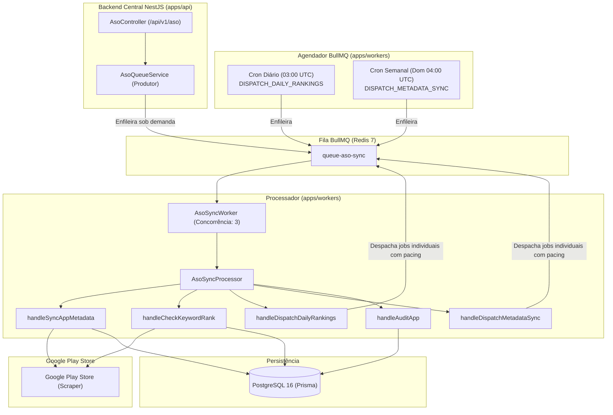

# Especificação Técnica: Workers Assíncronos & Filas ASO (Fase 14)

Este documento especifica a arquitetura, o funcionamento operacional, os contratos de tarefas e as políticas de resiliência do ecossistema de processamento em segundo plano do **ASO Studio** (`apps/workers`), operando sobre o **BullMQ** e **Redis 7**.

---

## 1. Topologia Operacional

O processamento assíncrono do ASO Studio desacopla a API REST das chamadas externas à Google Play Store e de rotinas pesadas de agregação e auditoria.



---

## 2. Contratos de Tarefas e Cargas de Trabalho

A fila `queue-aso-sync` suporta cinco tipos fundamentais de tarefas (definidos em `@mgp/contracts`):

| Tipo de Job (`AsoJobType`) | Payload | Responsabilidade |
|---|---|---|
| `SYNC_APP_METADATA` | `{ asoAppId, organizationId, forceAudit }` | Re-coleta metadados completos da loja para o app e dispara recálculo heurístico. |
| `CHECK_KEYWORD_RANK` | `{ asoAppId, appKeywordId, keyword, appId, country, lang, organizationId }` | Pesquisa a posição do app no top 100 orgânico da loja, atualiza ponteiros (`currentRank`, `previousRank`, `bestRank`) e grava histórico. |
| `DISPATCH_DAILY_RANKINGS` | `{ organizationId? }` | Varre todas as palavras-chave ativas (`isActive: true`) e enfileira checagens individuais com espaçamento (pacing). |
| `DISPATCH_METADATA_SYNC` | `{ organizationId? }` | Varre todos os apps monitorados (`isMonitored: true`) e enfileira tarefas de sincronização. |
| `AUDIT_APP` | `{ asoAppId, organizationId }` | Executa auditoria algorítmica (0-100) sobre os metadados cadastrados e grava laudo com recomendações. |

---

## 3. Políticas de Tolerância a Falhas e Resiliência

Para mitigar eventuais bloqueios ou lentidões da Google Play Store:

1. **Tentativas e Backoff Exponencial:**
   - Todo job possui até **3 tentativas automáticas** (`attempts: 3`).
   - Backoff exponencial iniciando em **2.000ms** (`type: 'exponential'`).
2. **Rate Limiting em Nível de Worker:**
   - O worker processa no máximo **5 requisições por segundo** (`limiter: { max: 5, duration: 1000 }`).
   - Concorrência limitada a **3 threads de execução simultânea** por instância de worker.
3. **Pacing em Lotes:**
   - Jobs gerados em lote por `DISPATCH_DAILY_RANKINGS` e `DISPATCH_METADATA_SYNC` são enfileirados com atraso progressivo (`delay = index * 300ms`), evitando rajadas (*burst*) de requisições.
4. **Idempotência Diária:**
   - Os jobs recebem IDs determinísticos (ex: `rank-check-{appKeywordId}-{YYYY-MM-DD}`), prevenindo duplicidade de processamento no mesmo ciclo diário.
5. **Retenção e Dead-Letter Queue (DLQ):**
   - Jobs concluídos: retidos por **24 horas** (limite de 1.000).
   - Jobs com falha definitiva: retidos por **7 dias** (limite de 5.000) para auditoria e reprocessamento operacional.

---

## 4. Agendamento Recorrente (Cron Schedules)

O módulo `AsoCronScheduler` gerencia os gatilhos automáticos nativos do BullMQ:

```ts
export const ASO_CRON_SCHEDULES = {
  DAILY_RANKINGS: {
    name: 'schedule-daily-rankings-03am',
    cron: '0 3 * * *', // Todos os dias às 03:00 UTC
    jobType: AsoJobType.DISPATCH_DAILY_RANKINGS,
  },
  WEEKLY_METADATA_SYNC: {
    name: 'schedule-weekly-metadata-sync-04am',
    cron: '0 4 * * 0', // Todo domingo às 04:00 UTC
    jobType: AsoJobType.DISPATCH_METADATA_SYNC,
  },
};
```

---

## 5. Endpoints de Controle na API REST

O `AsoController` expõe rotas protegidas por `JwtAuthGuard` e `TenantGuard` para interação com a fila:

| Método | Rota | Descrição |
|---|---|---|
| `POST` | `/api/v1/aso/apps/:id/sync-async` | Enfileira sincronização do app em segundo plano |
| `POST` | `/api/v1/aso/sync/dispatch-rankings` | Dispara re-checagem de todas as palavras-chave do tenant |
| `POST` | `/api/v1/aso/sync/dispatch-metadata` | Dispara sincronização em lote de todos os apps do tenant |
| `GET` | `/api/v1/aso/sync/metrics` | Retorna contadores operacionais da fila (waiting, active, failed, etc.) |

---

## 6. Cobertura de Testes Automatizados

A suíte de testes unitários da Fase 14 abrange:
- **`AsoSyncProcessor` (7 testes):** Validação de todos os tipos de jobs, mutações no PostgreSQL, injeção de dependências e rejeição de tipos inválidos.
- **`WorkerScraperService` (4 testes):** Mock de coleta, identificação de posição 1-based no ranking e tratamento de buscas sem resultados.
- **`WorkerAuditService` (3 testes):** Algoritmo heurístico, penalização de metadados ausentes e geração de recomendações.
- **`AsoCronScheduler` (2 testes):** Registro e verificação de cron jobs recorrentes no BullMQ.
- **`AsoQueueService` (6 testes na API):** Produtor BullMQ, injeção de tenant e métricas operacionais.

