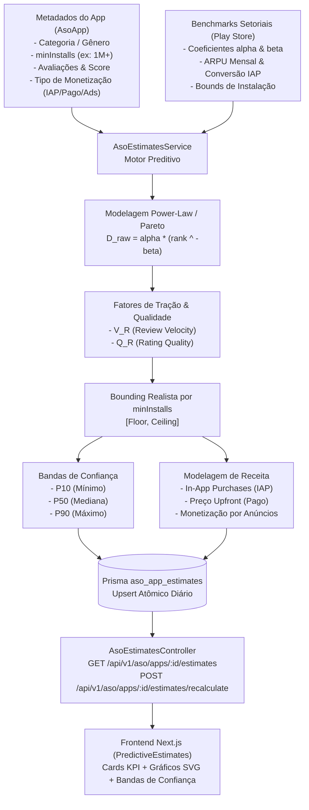

# 06. Motor Preditivo de Downloads e Receita (`AsoEstimatesService`)

## 1. Visão Geral da Arquitetura

A **Fase 29** inicia a **Etapa 5 (Inteligência Avançada & Modelos Preditivos)** da **Mobile Growth Platform (MGP)**, introduzindo a capacidade de estimar com alto rigor estatístico o volume de **downloads diários/mensais** e a **receita financeira gerada** por qualquer aplicativo público cadastrado no catálogo ASO, a partir de suas posições em rankings, marcos de downloads e velocidade de avaliações.

---

## 2. Metodologia Matemática: Distribuição de Pareto / Power-Law

A Google Play Store não divulga publicamente números exatos de downloads em tempo real nem faturamento privado dos desenvolvedores. Em conformidade com as diretrizes do projeto (`plataforma.pdf`), a MGP utiliza um modelo matemático fundamentado na teoria de cauda longa (*Power-Law*):

### 2.1. Curva Base Rank-para-Downloads
$$\text{Downloads}_{\text{base}}(r) = \alpha_{\text{cat, country}} \cdot r^{-\beta_{\text{cat, country}}}$$

- **$r$ (Rank Efetivo na Categoria):** Se o app figurar no Top Charts público, seu rank real é utilizado. Caso contrário, seu rank efetivo é inferido pela inversa da função de cauda longa a partir de seu marco de instalações (`minInstalls`) e tração recente.
- **$\alpha$ (Volume Base no Topo):** Representa a estimativa de downloads para a 1ª posição da categoria. Varia de $85.000$ (Games) a $25.000$ (Educação) no Brasil.
- **$\beta$ (Coeficiente de Decaimento):** Define a inclinação da curva de cauda longa ($0,75 \le \beta \le 0,88$).

### 2.2. Fatores de Ajuste (Tração & Qualidade)
1. **Velocidade de Avaliações ($V_R$):**
   $$V_R = \text{clamp}\left(0,85 + 0,3 \cdot \frac{\text{Reviews}}{\text{ExpectedReviews}}, \; 0,75, \; 1,45\right)$$
   Onde $\text{ExpectedReviews} = \max(10, \; \text{minInstalls} \cdot 0,015)$.
2. **Qualidade da Nota do Usuário ($Q_R$):**
   $$Q_R = \text{clamp}\left(0,65 + 0,55 \cdot \frac{\text{Score}}{5,0}, \; 0,76, \; 1,20\right)$$

### 2.3. Delimitação Realista (Floor / Ceiling Bounding)
Para evitar discrepâncias, o volume calculado é delimitado pelo marco de instalações públicas do app:
$$\text{Downloads}_{\text{diários}} = \max\left(D_{\text{floor}}, \; \min\left(D_{\text{ceil}}, \; D_{\text{base}} \cdot V_R \cdot Q_R\right)\right)$$

### 2.4. Intervalos de Confiança (P10, P50, P90)
- **Mínimo (P10):** $\text{round}(D_{\text{diários}} \cdot 0,75)$
- **Mediana (P50):** $D_{\text{diários}}$
- **Máximo (P90):** $\text{round}(D_{\text{diários}} \cdot 1,35)$
- **Projeção Mensal:** $\text{Daily} \times 30,4$ dias.

---

## 3. Modelo de Receita Setorial

A estimativa financeira avalia o tipo de monetização do aplicativo:
1. **Aplicativos Pagos (`PAID`):**
   $$\text{Receita Diária} = D_{\text{diários}} \cdot \text{Preço} \cdot 0,85$$
2. **Aplicativos com In-App Purchases (`FREE_IAP`):**
   $$\text{Receita Diária} = D_{\text{diários}} \cdot \left(\frac{\text{ARPU}_{\text{mensal}}}{30,4}\right) \cdot (\text{PayerConversionRate} \cdot 10)$$
3. **Aplicativos Gratuitos sem IAP (`FREE_ADS`):**
   $$\text{Receita Diária} = D_{\text{diários}} \cdot \text{AdArpuPerDownload}$$

---

## 4. Endpoints da API REST

Todos os endpoints operam sob autenticação JWT e validação multi-tenant (`TenantGuard`):

| Método | Endpoint | Descrição |
| :--- | :--- | :--- |
| `GET` | `/api/v1/aso/apps/:id/estimates?days=30&country=BR` | Retorna última estimativa, série temporal e taxas de crescimento (7d/30d). |
| `POST` | `/api/v1/aso/apps/:id/estimates/recalculate` | Força recálculo imediato do snapshot diário para a data corrente. |
| `GET` | `/api/v1/aso/benchmarks?category=GAME&country=BR` | Retorna coeficientes matemáticos e amostra de ranks de referência. |

---

## 5. Interface Gráfica no Dashboard (`apps/web`)

O componente [`PredictiveEstimates`](file:///f:/mobile_growth/apps/web/src/components/aso/predictive-estimates.tsx) está integrado como uma aba dedicada na página do app (`/aso/[id]`):
- **Cards de Métricas:** Mediana, faixas de variação, taxa de crescimento em 7 dias e 30 dias.
- **Gráfico SVG Responsivo:** Linha contínua da mediana (P50) combinada com área sombreada representativa do intervalo de confiança (P10 a P90).
- **Alternador de Métrica:** Alterna instantaneamente entre curva de **Downloads** e **Receita (BRL)**.
- **Aviso Metodológico:** Nota de transparência em conformidade com as políticas públicas da Google Play Store.

