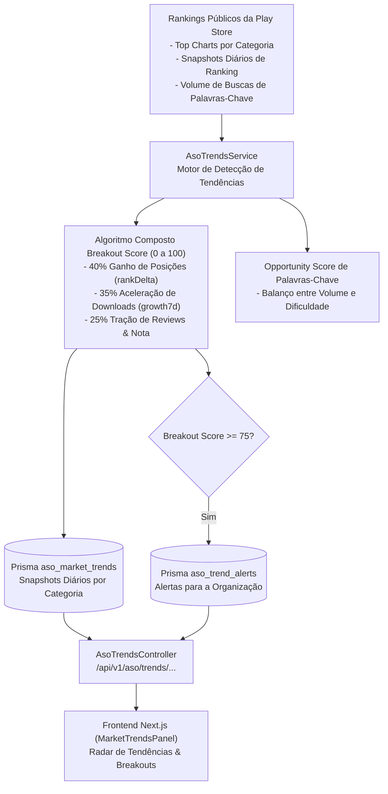

# 07. Monitoramento de Tendências de Mercado & Detecção de Breakouts (`AsoTrendsService`)

## 1. Visão Geral da Arquitetura

A **Fase 30** da **Mobile Growth Platform (MGP)** consolida a capacidade de inteligência competitiva e radar de oportunidades no ecossistema ASO, implementada pelo serviço [`AsoTrendsService`](file:///f:/mobile_growth/apps/api/src/modules/aso/services/aso-trends.service.ts).

O módulo monitora e detecta em tempo real:
1. **Aplicativos Breakout:** Aplicativos que registraram aceleração súbita em posições de ranking, tração de downloads diários e velocidade de avaliações.
2. **Palavras-Chave em Alta Demanda:** Termos de busca com alto volume, aceleração de pesquisas recente e índice de oportunidade favorável.
3. **Feed de Alertas Inteligentes (`AsoTrendAlert`):** Alertas proativos disparados para organizações que atuam no mesmo segmento de um aplicativo em ascensão.

---

## 2. Algoritmo de Cálculo do Breakout Score

Para mitigar ruídos e flutuações estatísticas pontuais, o **Breakout Score** ($\mathcal{B} \in [0, 100]$) combina três dimensões complementares de tração:

$$\mathcal{B} = \text{round}\left(0,40 \cdot S_{\text{rank}} + 0,35 \cdot S_{\text{growth}} + 0,25 \cdot S_{\text{traction}}\right)$$

Onde:
* **$S_{\text{rank}}$ (Score de Salto de Posições):**
  $$S_{\text{rank}} = \min(100, \; \max(0, \; \Delta \text{Rank} \cdot 5,0))$$
* **$S_{\text{growth}}$ (Score de Crescimento de Downloads):**
  $$S_{\text{growth}} = \min(100, \; \max(0, \; \text{Growth}_{7d} \cdot 2,0))$$
* **$S_{\text{traction}}$ (Score de Velocidade de Avaliações e Nota):**
  $$S_{\text{traction}} = \min\left(100, \; \max\left(20, \; \frac{\text{Reviews}}{\max(1, \text{minInstalls} \cdot 0,01)} \cdot 30 + \text{Score} \cdot 10\right)\right)$$

### Classificação de Risco e Oportunidade:
* $\mathcal{B} \ge 85$: **Crescimento Explosivo** (`HIGH` severity).
* $75 \le \mathcal{B} < 85$: **Alta Tração / Oportunidade** (`OPPORTUNITY` severity).
* $50 \le \mathcal{B} < 75$: **Em Ascensão Gradual** (`INFO` severity).

---

## 3. Endpoints da API REST

Todos os endpoints operam sob autenticação JWT e validação multi-tenant ([`TenantGuard`](file:///f:/mobile_growth/apps/api/src/common/guards/tenant.guard.ts)):

| Método | Endpoint | Descrição |
| :--- | :--- | :--- |
| `GET` | `/api/v1/aso/trends/categories/:category` | Consulta tendências e breakouts da categoria (ex: `FINANCE`, `GAME`, `SHOPPING`). |
| `GET` | `/api/v1/aso/trends/breakouts` | Lista aplicativos em ascensão com filtros por categoria, país e `minBreakoutScore`. |
| `GET` | `/api/v1/aso/trends/keywords` | Retorna palavras-chave em alta no mercado com cálculo de oportunidade. |
| `GET` | `/api/v1/aso/trends/alerts` | Feed de alertas inteligentes de concorrência e mercado gerados para o tenant. |
| `PATCH`| `/api/v1/aso/trends/alerts/:id/read` | Marca notificação de tendência como lida pela organização. |

---

## 4. Interface Web no Dashboard (`apps/web`)

O painel [`MarketTrendsPanel`](file:///f:/mobile_growth/apps/web/src/components/aso/market-trends-panel.tsx) foi integrado como uma aba dedicada na página principal do ASO Studio (`/aso`):
* **Seletor de Categorias por Pills:** Navegação rápida entre Finanças, Jogos, E-commerce, Produtividade, Ferramentas e Redes Sociais.
* **Indicadores Setoriais:** Índice de crescimento setorial consolidado em 7 dias e volume total de aplicativos monitorados no radar.
* **Tabela de Breakout Apps:** Badges de salto de posições (`▲ +18 posições`), download diário estimado e botão de um clique para adicionar o aplicativo aos concorrentes monitorados da organização.
* **Radar de Oportunidades de Palavras-Chave:** Lista de termos em demanda com pontuação de oportunidade calculada.
* **Feed de Alertas:** Notificações em tempo real com indicador de severidade e ação de confirmação de leitura.

