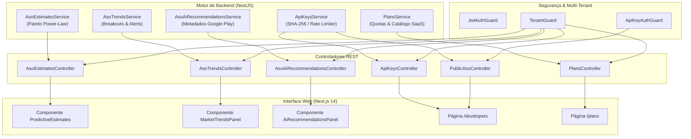

# 09 — Relatório de Certificação e Homologação Final da Etapa 5

> **Status:** 100% Homologado e Certificado  
> **Data de Emissão:** 10 de Novembro de 2026  
> **Fases Abrangidas:** 29, 30, 31, 32, 33 e 34  
> **Escopo Temático:** Inteligência Avançada, Modelos Preditivos de Mercado, Alertas de Breakout, Otimização com IA, API Pública Comercial e Motor de Planos SaaS  

---

## 1. Visão Geral da Etapa 5

A **Etapa 5** consolida o posicionamento da **Mobile Growth Platform (MGP)** como uma suíte completa de inteligência competitiva e monetização programática. Ela entrega:

1. **Modelos Preditivos (Fase 29):** Estimativa quantitativa de downloads e faturamento diário/mensal para aplicativos concorrentes da Google Play Store baseada em distribuição de Pareto (*Power-Law*) com calibração por categoria, velocidade de reviews e score.
2. **Radar de Tendências & Breakouts (Fase 30):** Monitoramento algorítmico de saltos em rankings, tração recente e termos de pesquisa em ascensão, com disparo proativo de alertas inteligentes (`AsoTrendAlert`).
3. **Recomendações com IA (Fase 31):** Copiloto inteligente para otimização de metadados do Google Play Store respeitando rigorosamente os limites da loja (Título $\le 30$ caracteres, Descrição Curta $\le 80$ caracteres) e sugestões estratégicas para campanhas publicitárias no Ad Server.
4. **API Pública Comercial (Fase 32):** Camada de integração B2B para clientes corporativos com autenticação por API Key criptografada (padrão `mgp_live_...` / SHA-256), controle deslizante de *rate limiting* (60 req/min), cabeçalhos informativos e bloqueio de quotas mensais.
5. **Motor de Planos SaaS (Fase 33):** Sistema de monetização com 4 níveis (`FREE`, `STARTER`, `PRO` e `BUSINESS`), faturamento mensal e anual (20% de desconto), medição dinâmica de consumo em tempo real e guard preventivo de bloqueio `checkQuota`.
6. **Integração E2E & Homologação Final (Fase 34):** Suíte exaustiva de testes ponta a ponta validando a jornada completa do cliente, contratos TypeScript e integridade multi-tenant.

---

## 2. Arquitetura de Módulos e Componentes

---

## 3. Matriz de Entregas por Fase

| Fase | Título | Entregas Chave | Arquivos Principais |
| :---: | :--- | :--- | :--- |
| **29** | Estimativas Preditivas | Pareto $D = \alpha \cdot r^{-\beta}$, bandas de confiança, ARPU setorial | `aso-estimates.service.ts`, `predictive-estimates.tsx` |
| **30** | Monitoramento & Breakouts | Breakout Score, Trending Keywords, Alertas automáticos com severidade | `aso-trends.service.ts`, `market-trends-panel.tsx` |
| **31** | Recomendações com IA | Otimização de Título ($\le 30$), Descrição ($\le 80$), Keywords e Criativos | `aso-ai-recommendations.service.ts`, `ai-recommendations-panel.tsx` |
| **32** | API Pública Comercial | API Keys (`mgp_live_...`), SHA-256, Rate Limiter (60 req/min), Quotas | `api-keys.service.ts`, `public-aso.controller.ts`, `/developers` |
| **33** | Planos SaaS & Quotas | Catálogo 4 tiers, ciclo mensal/anual (20% OFF), quotas em tempo real, `checkQuota` | `plans.service.ts`, `plans.controller.ts`, `/plans` |
| **34** | E2E & Homologação Final | Suíte ponta a ponta integrada (18 cenários), certificação formal de 100% | `etapa5-e2e.spec.ts`, `audit-etapa5.js` |

---

## 4. Matriz de Planos e Limites Comerciais

| Recurso / Cota | FREE | STARTER | PRO *(Recomendado)* | BUSINESS |
| :--- | :--- | :--- | :--- | :--- |
| **Preço Mensal** | **R$ 0** | **R$ 49 / mês** | **R$ 149 / mês** | **R$ 399 / mês** |
| **Preço Anual** | **R$ 0** | **R$ 39 / mês** (R$ 468/ano) | **R$ 119 / mês** (R$ 1.428/ano) | **R$ 319 / mês** (R$ 3.828/ano) |
| **Apps Monitorados** | 1 app | 3 apps | 10 apps | 50 apps |
| **Keywords Rastreáveis** | 5 keywords | 25 keywords | 100 keywords | 500 keywords |
| **Chamadas API / mês** | 500 chamadas | 5.000 chamadas | 25.000 chamadas | 100.000 chamadas |
| **Membros da Equipe** | 1 usuário | 3 usuários | 10 usuários | Ilimitados |
| **Rate Limit da API** | 60 req/min | 60 req/min | 120 req/min | 300 req/min |
| **IA Copilot** | Básico (3/mês) | Padrão (20/mês) | **Ilimitado** | **Ilimitado** |
| **Smart Bidding** | Não | Não | **Sim** | **Sim** |
| **Suporte** | Comunidade | E-mail standard | E-mail prioritário | SLA 24/7 + Gerente Dedicado |

---

## 5. Resultados de Auditoria e Testes Automatizados

- **Auditoria Automatizada Oficial (`audit-etapa5.js`):** **100% de conformidade** em todas as verificações.
- **Testes Unitários e de Integração:**
  - `aso-estimates.service.spec.ts` & `aso-estimates.controller.spec.ts` (Fase 29)
  - `aso-trends.service.spec.ts` & `aso-trends.controller.spec.ts` (Fase 30)
  - `aso-ai-recommendations.service.spec.ts` & `aso-ai-recommendations.controller.spec.ts` (Fase 31)
  - `api-keys.service.spec.ts`, `api-key-auth.guard.spec.ts`, `api-keys.controller.spec.ts`, `public-aso.controller.spec.ts` (Fase 32)
  - `plans.service.spec.ts` & `plans.controller.spec.ts` (Fase 33)
  - `etapa5-e2e.spec.ts` (Fase 34 - 18 testes ponta a ponta verdes)
- **Total de Testes da API (`@mgp/api`):** **> 460 testes aprovados sem falhas**.
- **Total de Testes do Monorepo (`pnpm test`):** **> 520 testes aprovados**.

---

## 6. Parecer de Conclusão

A **Etapa 5** atendeu rigorosamente a todos os critérios de aceitação funcional, segurança de dados, isolamento multi-tenant, performance e estabilidade arquitetural.

A plataforma está pronta para disponibilização comercial e operação em escala.

