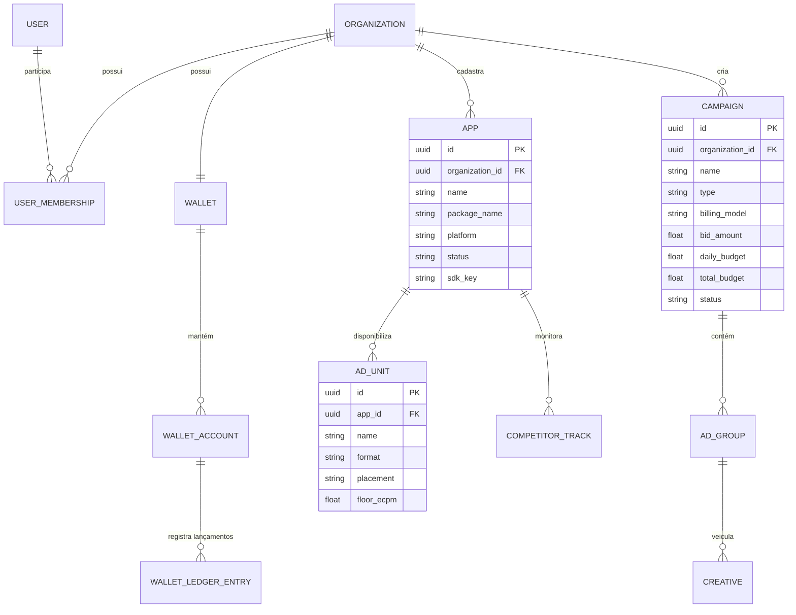

# 06. Modelo Conceitual de Dados e Arquitetura do Ledger Financeiro

## 1. Visão Geral do Banco de Dados

O ecossistema **MGP** utiliza uma estratégia híbrida de armazenamento:
1. **PostgreSQL 16 (Relacional / ACID / Transacional):** Entidades do negócio, controle de acesso, campanhas e o **Razão Contábil Imutável (Ledger)**.
2. **Redis 7.x (Em Memória):** Pacing em tempo real de campanhas, frequency capping por usuário, blacklist de tokens e filas BullMQ.
3. **ClickHouse (Colunar / Analítico):** Armazenamento de séries temporais de impressões, cliques brutos e telemetria profunda.

---

## 2. Diagrama Entidade-Relacionamento (Core Transacional)



---

## 3. Arquitetura do Razão Contábil (Double-Entry Financial Ledger)

O saldo financeiro e os créditos de publicidade da plataforma **não são geridos por simples colunas incrementais (`balance += valor`)** na tabela da organização. Esse modelo ingênuo gera inconsistências concorrentes, perda de rastreabilidade e vulnerabilidade a fraudes.

A MGP implementa um **Ledger Contábil de Partida Dobrada / Append-Only**. O saldo é sempre o resultado determinístico da soma histórica dos lançamentos imutáveis.

### 3.1. As Três Contas Distintas da Carteira (`WalletAccount`)
Cada organização possui uma carteira raiz dividida estritamente em três saldos isolados:

1. **`ADVERTISING_CREDITS` (Créditos Comprados):**
   * Adquiridos via pagamento direto (PIX, Boleto, Cartão de Crédito).
   * Destinados exclusivamente ao consumo em campanhas pagas do anunciante.
2. **`EXCHANGE_CREDITS` (Créditos de Troca / Permuta):**
   * Gerados quando o aplicativo do desenvolvedor exibe anúncios de terceiros no módulo de permuta.
   * Utilizados exclusivamente para veicular seus próprios aplicativos na rede de permuta.
   * **Inviolabilidade:** Jamais podem ser resgatados em dinheiro vivo (saque financeiro).
3. **`PUBLISHER_EARNINGS` (Ganhos Reais de Monetização):**
   * Receita financeira líquida gerada por impressões de campanhas pagas exibidas nos apps do publisher.
   * Elegível para saque bancário após fechamento do período de validação antifraude.

---

## 4. Estrutura das Tabelas do Ledger (PostgreSQL / Prisma)

```prisma
enum WalletAccountType {
  ADVERTISING_CREDITS
  EXCHANGE_CREDITS
  PUBLISHER_EARNINGS
}

enum LedgerTransactionType {
  DEPOSIT_FIAT          // Depósito em R$ convertido em créditos de anúncio
  EXCHANGE_EARNED       // Créditos gerados por impressões de permuta entregues
  EXCHANGE_CONSUMED     // Créditos de permuta consumidos em campanhas próprias
  CAMPAIGN_SPEND        // Débito de crédito por impressão/clique em campanha paga
  PUBLISHER_CREDIT      // Crédito de receita financeira gerada pelo publisher
  PAYOUT_WITHDRAWAL     // Saque bancário executado
  FRAUD_CHARGEBACK      // Estorno manual ou automatizado decorrente de tráfego inválido
  SYSTEM_ADJUSTMENT     // Correção administrativa auditada
}

model Wallet {
  id              String          @id @default(uuid())
  organizationId  String          @unique @map("organization_id")
  organization    Organization    @relation(fields: [organizationId], references: [id], onDelete: Cascade)
  accounts        WalletAccount[]
  createdAt       DateTime        @default(now()) @map("created_at")

  @@map("wallets")
}

model WalletAccount {
  id              String            @id @default(uuid())
  walletId        String            @map("wallet_id")
  wallet          Wallet            @relation(fields: [walletId], references: [id], onDelete: Cascade)
  type            WalletAccountType
  currency        String            @default("BRL") // ou "CREDITS"
  cachedBalance   Decimal           @default(0.0) @db.Decimal(14, 4) @map("cached_balance")
  ledgerEntries   WalletLedger[]

  @@unique([walletId, type])
  @@map("wallet_accounts")
}

model WalletLedger {
  id              String                @id @default(uuid())
  accountId       String                @map("account_id")
  account         WalletAccount         @relation(fields: [accountId], references: [id], onDelete: Restrict)
  transactionType LedgerTransactionType @map("transaction_type")
  amount          Decimal               @db.Decimal(14, 4) // Positivo = Crédito, Negativo = Débito
  balanceAfter    Decimal               @db.Decimal(14, 4) @map("balance_after")
  referenceId     String?               @map("reference_id") // UUID da campanha, invoice ou payout
  idempotencyKey  String                @unique @map("idempotency_key") // Prevenção de duplicidade
  description     String
  metadata        Json?
  createdAt       DateTime              @default(now()) @map("created_at")

  @@index([accountId, createdAt])
  @@map("wallet_ledger")
}
```

---

## 5. Garantias de Integridade Financeira (Invariantes)

1. **Idempotência Obrigatória:** Cada lançamento contábil exige uma `idempotency_key` (ex: `imp_hash_uuid`). Se a mesma transação for reenviada, a inserção é ignorada sem duplicar saldos.
2. **Proibição de Saldo Negativo:** Operações de débito de orçamento (`CAMPAIGN_SPEND`) verificam atomicamente o saldo disponível com cláusula `SELECT FOR UPDATE` na transação do PostgreSQL. Se `cachedBalance + amount < 0`, a operação é rejeitada.
3. **Reconciliação Automatizada:** Um worker diário recalcula `SUM(amount)` de cada conta e compara com o `cachedBalance`. Se houver divergência de 1 centavo, a conta é congelada e um alerta crítico é disparado para o NOC.

