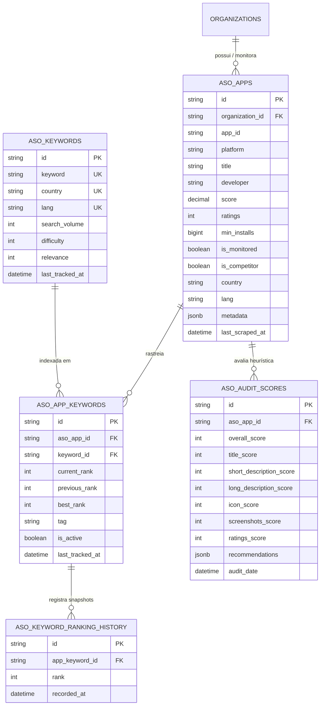

# 02. Modelagem de Dados ASO no Prisma (Catálogo, Palavras-chave e Histórico)

## 1. Visão Geral da Arquitetura de Dados

A **Fase 12** da **Mobile Growth Platform (MGP)** estabelece o esquema relacional do **Motor de Inteligência & ASO (App Store Optimization)** no PostgreSQL 16 via Prisma ORM.

Essa modelagem sustenta a indexação de aplicativos monitorados, portfólio de concorrentes, rastreamento de palavras-chave, séries temporais de rankings e auditorias heurísticas de metadados da Google Play Store, com estrito isolamento multi-tenant por organização.

---

## 2. Tabelas e Modelos Estruturados

### 2.1. `aso_apps` (Catálogo e Monitoramento de Aplicativos)
Armazena tanto os aplicativos da própria organização quanto aplicativos concorrentes ou de benchmark de mercado:
- `id`: Identificador único (UUIDv4).
- `organization_id`: Tenant proprietário do monitoramento (chave estrangeira para `organizations.id` com `ON DELETE CASCADE`).
- `app_id`: Package name oficial da Google Play Store (ex: `com.whatsapp`, `com.spotify.music`).
- `platform`: Plataforma (`ANDROID` ou `IOS`, padrão `ANDROID`).
- `title`, `developer`, `developer_id`, `icon`, `genre`, `genre_id`.
- `score`, `ratings`, `reviews`, `min_installs`: Métricas quantitativas de performance da loja.
- `is_monitored`: Indica se o aplicativo está ativo no fluxo periódico de scraping e monitoramento.
- `is_competitor`: Distingue entre o aplicativo principal da organização e concorrentes mapeados.
- `target_app_id`: Package name do aplicativo alvo de referência para comparação em benchmark.
- `country` e `lang`: Segmentação geográfica e idiomática (padrão: `br` e `pt-BR`).
- `metadata`: Snapshot JSON completo com descrição, screenshots, recent changes e tags.
- `last_scraped_at`: Timestamp do último ciclo de sincronização com o Google Play Scraper Engine.

### 2.2. `aso_keywords` (Dicionário Global de Palavras-chave)
Catálogo normalizado de termos de busca da Play Store para evitar duplicação de métricas globais de mercado:
- `id`: UUIDv4.
- `keyword`: Termo de pesquisa canônico em caixa baixa (ex: `"finanças pessoais"`, `"jogos de corrida"`).
- `country` e `lang`: Segmentação regional do termo.
- `search_volume`: Estimativa ponderada de volume/popularidade de busca (escala de 0 a 100).
- `difficulty`: Índice de concorrência orgânica estimada (0 a 100).
- `relevance`: Score de adequação semântica.
- `last_tracked_at`: Timestamp da última atualização de métricas do termo.

### 2.3. `aso_app_keywords` (Relação de Rastreamento de Palavra-chave por App)
Tabela associativa entre o aplicativo monitorado e as palavras-chave cadastradas pela organização:
- `id`: UUIDv4.
- `aso_app_id`: Vínculo com `aso_apps.id`.
- `keyword_id`: Vínculo com `aso_keywords.id`.
- `current_rank`: Posição atual de indexação na Google Play Store (1 a 100, ou `null` se não rankeado).
- `previous_rank`: Posição na coleta imediatamente anterior.
- `best_rank`: Melhor posição histórica atingida pelo aplicativo para o termo.
- `tag`: Classificação definida pelo usuário (ex: `'core'`, `'brand'`, `'competitor'`, `'discovery'`).
- `is_active`: Controle de habilitação do rastreamento.
- `last_tracked_at`: Data e hora da última verificação de posição.

### 2.4. `aso_keyword_ranking_history` (Histórico Temporal de Rankings)
Série temporal para renderização de gráficos de evolução diária e sazonal de posições:
- `id`: UUIDv4.
- `app_keyword_id`: Vínculo com `aso_app_keywords.id`.
- `rank`: Posição exata registrada no instante da amostragem (1 a 100).
- `recorded_at`: Data e hora do snapshot.

### 2.5. `aso_audit_scores` (Auditoria Heurística e Checklist ASO)
Avaliações periódicas da qualidade e otimização da página do aplicativo na loja:
- `id`: UUIDv4.
- `aso_app_id`: Vínculo com `aso_apps.id`.
- `overall_score`: Pontuação geral de 0 a 100.
- `title_score`: Avaliação do título (tamanho ótimo, densidade de keywords).
- `short_description_score`: Análise do subtítulo/resumo (até 80 caracteres).
- `long_description_score`: Análise da descrição completa (densidade de termos, estruturação).
- `icon_score`: Qualidade e contraste do ícone.
- `screenshots_score`: Quantidade (mínimo 3) e resolução das capturas de tela.
- `ratings_score`: Nota média e proporção de avaliações positivas.
- `recommendations`: Objeto JSON estruturado contendo categoria, severidade (`HIGH`, `MEDIUM`, `LOW`, `INFO`), mensagem explicativa e ação corretiva sugerida.
- `audit_date`: Data da execução do diagnóstico.

---

## 3. Índices e Performance no PostgreSQL

- **Chaves Compostas Únicas:**
  - `aso_apps_organization_id_app_id_country_lang_key`: Impede duplicação do mesmo aplicativo para um mesmo tenant e locale.
  - `aso_keywords_keyword_country_lang_key`: Garante unicidade de keywords por locale no mercado.
  - `aso_app_keywords_aso_app_id_keyword_id_key`: Garante que um app não tenha keywords duplicadas no mesmo monitoramento.
- **Índices de Cobertura e Rastreamento:**
  - `aso_apps_organization_id_is_monitored_idx`: Otimiza listagens de apps ativos no painel do usuário.
  - `aso_app_keywords_aso_app_id_current_rank_idx`: Acelera a ordenação da tabela de palavras-chave por ranking no ASO Studio.
  - `aso_keyword_ranking_history_app_keyword_id_recorded_at_idx`: Alta velocidade na geração de gráficos de séries temporais de rankings.

---

## 4. Migrations e Versionamento

- **Migration Criada:** [`packages/database/prisma/migrations/20261105000000_aso_engine/migration.sql`](file:///f:/mobile_growth/packages/database/prisma/migrations/20261105000000_aso_engine/migration.sql)
- **Contratos Compartilhados:** [`packages/contracts/src/aso.contracts.ts`](file:///f:/mobile_growth/packages/contracts/src/aso.contracts.ts)
- **Suíte de Testes de Banco:** [`apps/api/src/modules/aso/aso-database.spec.ts`](file:///f:/mobile_growth/apps/api/src/modules/aso/aso-database.spec.ts)
- **Seed Demonstrativo:** Atualizado em [`packages/database/prisma/seed.ts`](file:///f:/mobile_growth/packages/database/prisma/seed.ts)

