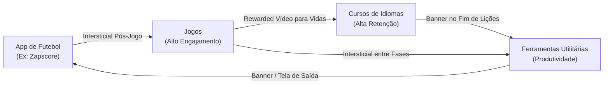

# 01. Visão Geral e Estratégia de House Ads

## 1. O Que É o MGP House Ads?

O **MGP House Ads** é a funcionalidade da Mobile Growth Platform que permite a um publicador (publisher) veicular campanhas promocionais de seus próprios produtos e aplicativos dentro de outros aplicativos de seu próprio portfólio.

Diferente de campanhas pagas de anunciantes externos (onde há cobrança por impressão ou clique e intermediação de ad networks), o House Ad opera com **custo de mídia zero (CAC = R$ 0,00)** e **isenção de saldo financeiro em carteira**.

---

## 2. Vantagens Estratégicas para o Publisher

1. **Aproveitamento Total de Inventário (100% Fill Rate):**
   * Nenhum espaço publicitário fica em branco quando redes terceiras (como Google AdMob, Unity Ads ou AppLovin) não têm anúncios para entregar na sua região ou para aquele perfil de usuário.
2. **Crescimento Orgânico Cruzado (Efeito Volante / Network Effect):**
   * Usuários fiéis de um app seu são direcionados diretamente para instalar outros aplicativos da sua rede na Google Play Store.
3. **Controle Editorial Absoluto:**
   * Você decide exatamente quais criativos, mensagens, temas e benefícios são promovidos, sem risco de anúncios inapropriados de concorrentes aparecerem no seu app.
4. **Isenção de Comissões e Taxas:**
   * 100% do valor do usuário adquirido permanece dentro do seu negócio.
5. **Ultra-Baixa Latência (< 30ms):**
   * O Ad Server da MGP é executado em instâncias Fastify otimizadas na nuvem com cache Redis em memória, garantindo entrega instantânea sem travar a renderização do seu app.

---

## 3. Matriz de Promoção Cruzada (Cross-Promotion Matrix)

Para maximizar a conversão de downloads entre os seus aplicativos, recomendamos a seguinte matriz de afinidade de público:

### Regras de Afinidade por Categoria:
* **Futebol $\rightarrow$ Jogos:** Alta taxa de conversão em dias de clássicos e finais de semana. Usuários que acompanham partidas esportivas têm elevada propensão a instalar jogos casuais e competitivos.
* **Jogos $\rightarrow$ Idiomas e Futebol:** Em jogos, o formato **Vídeo Recompensado (Rewarded Ad)** é o campeão de engajamento. Oferecer moedas, vidas ou dicas em troca de assistir ao vídeo do app de idiomas ou do app de futebol gera CTR médio acima de **8% a 12%**.
* **Ferramentas Utilitárias $\rightarrow$ Cursos de Idiomas:** O usuário de utilitários busca eficiência e autoaperfeiçoamento. Banners e cards nativos com chamadas como *"Aprenda Inglês em 15 minutos por dia"* convertem com grande eficácia.
* **Cursos de Idiomas $\rightarrow$ Ferramentas Utilitárias:** Ao concluir módulos de estudo, o usuário pode ser apresentado a utilitários complementares (calculadoras, organizadores de tarefas, leitores de documentos).

---

## 4. Formatos Suportados na Plataforma

| Formato | Dimensões | Comportamento no App | Melhor Momento de Exibição |
| :--- | :--- | :--- | :--- |
| **BANNER** | 320x50 dp | Barra fixa no rodapé ou topo com auto-refresh a cada 30-60s. | Telas de navegação contínua (ex: tela de placar ao vivo, listagem de lições). |
| **INTERSTITIAL** | Tela Cheia (FullScreen) | Bloqueio temporário com botão de fechar (X) após 5 segundos. | Pausas naturais da experiência (saída de tela de detalhes, fim de partida, troca de fases). |
| **REWARDED** | Vídeo Tela Cheia (15-30s) | Vídeo não-pulável que recompensa o usuário ao final. | Acesso a recursos premium, moedas de jogo, remoção temporária de anúncios. |
| **NATIVE** | Customizável | Componente nativo integrado ao feed/lista do app (ícone, título, CTA). | Feeds de notícias de futebol, cards entre partidas de uma rodada. |

---

## 5. Como Funciona a Entrega Técnica (RTB Interno)

1. **Requisição do SDK:** O aplicativo envia um payload JSON enxuto para o endpoint `/ads/decision` informando o `sdkKey`, o `adUnitId`, o formato solicitado e metadados do dispositivo (país, ID de publicidade GAID).
2. **Seleção de Campanhas Elegíveis:** O motor de decisão filtra apenas as campanhas do tipo `HOUSE_AD` ativas na mesma organização que possuem criativos compatíveis com o formato.
3. **Controle de Frequência (Frequency Capping):** Se o usuário já visualizou essa campanha o número máximo de vezes na hora configurado (ex: 3 vezes), o motor descarta essa campanha e busca a próxima do seu portfólio.
4. **Desempate por Lance Nominal (Peso):** Se você configurou um lance de $2.00 na campanha do Jogo e $1.00 no app de Idiomas, o Jogo é entregue prioritariamente até atingir o seu teto de frequência.
5. **Geração de Tokens Criptográficos:** O Ad Server devolve o anúncio com tokens HMAC de impressão e clique protegidos contra adulteração e replay.
