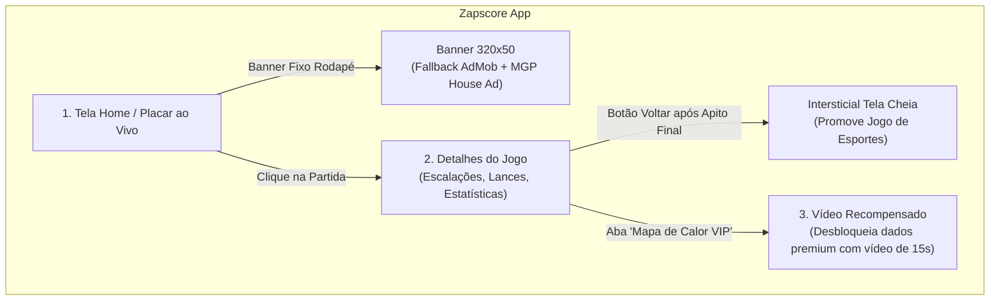

# 06. Caso Prático: Integração no Aplicativo Zapscore

Este guia detalha a aplicação prática da estratégia de **House Ads e Cross-Promotion** no aplicativo **Zapscore** (aplicativo de futebol com placar ao vivo, notícias e estatísticas de partidas).

---

## 1. Perfil de Audiência e Comportamento no Zapscore

O público de um aplicativo como o **Zapscore** possui características comportamentais ideais para promoção cruzada:
* **Picos Intensos de Tráfego:** Concentração elevada em noites de quarta-feira, sábados e domingos à tarde.
* **Sessões Curtas e Frequentes:** O usuário abre o app dezenas de vezes durante os 90 minutos de uma rodada para conferir gols, cartões e resultados.
* **Afinidade Temática:** Elevado interesse em entretenimento, jogos competitivos, apostas esportivas, viagens e ferramentas práticas.

---

## 2. Mapa de Monetização e Espaços no Zapscore



---

## 3. Implementação Prática por Tela

### Tela 1: Placar ao Vivo (Tela Principal)
* **Formato:** `BANNER` (320x50 dp) fixado no rodapé.
* **Comportamento:** Opera no modo **Fallback Inteligente**. O AdMob tenta faturar primeiro; se não houver anúncio pago disponível, o **MGP House Ad** entra imediatamente promovendo o seu **App de Cursos de Idiomas** ou seu **App Utilitário**.
* **Criativo Recomendado:**
  * Imagem: 320x50 com cores contrastantes (azul escuro e amarelo).
  * Texto: *"Aprenda Inglês para viajar e ver jogos no exterior. Comece Grátis!"*.
  * Link: Play Store com tag UTM `?referrer=utm_source%3Dzapscore_banner_home`.

### Tela 2: Detalhes da Partida e Saída (Transição)
* **Formato:** `INTERSTITIAL` (Tela Cheia).
* **Gatilho de Disparo:** Nunca abra o anúncio quando o usuário estiver no meio da leitura de um lance importante. O momento ideal é:
  1. Quando a partida estiver finalizada (status `FINISHED` / 90'+);
  2. Quando o usuário clica no botão Voltar ou troca de campeonato.
* **Criativo Recomendado:**
  * Imagem de tela cheia vertical (1080x1920 px) promovendo o seu **App de Jogos**.
  * Título: *"Gosta de Futebol? Venha Desafiar Seus Amigos no Nosso Game!"*.
  * Botão: `Jogar Agora`.

### Tela 3: Recursos Premium Desbloqueados por Vídeo (Rewarded Ad)
* **Formato:** `REWARDED` (Vídeo de 15 a 30 segundos).
* **Conceito:** No Zapscore, ofereça recursos avançados gratuitos em troca de assistir a um vídeo promocional:
  * *"Desbloquear Mapa de Calor dos Jogadores por 24 horas"*;
  * *"Ver Probabilidade de Vitória e Estatísticas Avançadas xG"*.
* **Benefício:** O usuário se sente beneficiado (ganhou um recurso VIP sem pagar assinatura) e assiste com 100% de atenção ao vídeo do seu outro aplicativo.

---

## 4. Código do Zapscore: Gerenciador Central de Anúncios

Crie uma classe singleton no seu projeto do Zapscore para centralizar todas as chamadas de anúncios:

```kotlin
package com.zapscore.app.ads

import android.app.Activity
import android.content.Context
import android.util.Log
import android.widget.FrameLayout
import com.google.android.gms.ads.AdListener
import com.google.android.gms.ads.AdRequest
import com.google.android.gms.ads.AdSize
import com.google.android.gms.ads.AdView
import com.google.android.gms.ads.LoadAdError
import com.mgp.sdk.ads.banner.MgpBannerView
import com.mgp.sdk.ads.interstitial.MgpInterstitialAd
import com.mgp.sdk.ads.interstitial.MgpInterstitialListener
import com.mgp.sdk.ads.rewarded.MgpRewardedAd
import com.mgp.sdk.ads.rewarded.MgpRewardedListener
import com.mgp.sdk.ads.rewarded.MgpRewardItem

object ZapscoreAdsManager {

    // Chaves configuradas no painel da MGP
    private const val MGP_BANNER_AD_UNIT = "mgp_adunit_zapscore_banner"
    private const val MGP_INTERSTITIAL_AD_UNIT = "mgp_adunit_zapscore_interstitial"
    private const val MGP_REWARDED_AD_UNIT = "mgp_adunit_zapscore_rewarded"

    // AdMob IDs
    private const val ADMOB_BANNER_ID = "ca-app-pub-xxxxxxxxxxxxxxxx/yyyyyyyyyy"

    /**
     * Vincula o banner com fallback automático no contêiner de rodapé
     */
    fun attachLiveScoreBanner(activity: Activity, container: FrameLayout) {
        val admobView = AdView(activity).apply {
            setAdSize(AdSize.BANNER)
            adUnitId = ADMOB_BANNER_ID
        }

        container.removeAllViews()
        container.addView(admobView)

        admobView.adListener = object : AdListener() {
            override fun onAdFailedToLoad(error: LoadAdError) {
                Log.w("ZapscoreAds", "AdMob vazio. Subindo House Ad MGP...")
                container.removeAllViews()
                val mgpBanner = MgpBannerView(activity)
                container.addView(mgpBanner)
                mgpBanner.loadAd(MGP_BANNER_AD_UNIT)
            }
        }

        admobView.loadAd(AdRequest.Builder().build())
    }

    /**
     * Exibe o Intersticial de tela cheia
     */
    fun showMatchExitInterstitial(activity: Activity, onClosed: () -> Unit) {
        MgpInterstitialAd.load(activity, MGP_INTERSTITIAL_AD_UNIT, object : MgpInterstitialListener {
            override fun onAdLoaded(ad: MgpInterstitialAd) {
                ad.show(activity)
            }
            override fun onAdFailedToLoad(error: String) {
                onClosed()
            }
            override fun onAdDismissed() {
                onClosed()
            }
            override fun onAdClicked() {}
        })
    }

    /**
     * Exibe o Vídeo Recompensado para destravar estatísticas VIP
     */
    fun showRewardedForHeatmap(activity: Activity, onRewardUnlocked: () -> Unit) {
        MgpRewardedAd.load(activity, MGP_REWARDED_AD_UNIT, object : MgpRewardedListener {
            override fun onAdLoaded(ad: MgpRewardedAd) {
                ad.show(activity)
            }
            override fun onAdFailedToLoad(error: String) {
                Log.e("ZapscoreAds", "Erro ao carregar vídeo: $error")
            }
            override fun onUserEarnedReward(reward: MgpRewardItem) {
                onRewardUnlocked()
            }
            override fun onAdDismissed() {}
        })
    }
}
```

---

## 5. Chamada Simples nas Activities do Zapscore

Na sua tela de Placar ao Vivo (`LiveScoresActivity.kt`):
```kotlin
override fun onCreate(savedInstanceState: Bundle?) {
    super.onCreate(savedInstanceState)
    setContentView(R.layout.activity_live_scores)

    val bannerContainer = findViewById<FrameLayout>(R.id.bannerContainer)
    ZapscoreAdsManager.attachLiveScoreBanner(this, bannerContainer)
}
```

Ao sair da tela de detalhes da partida (`MatchDetailActivity.kt`):
```kotlin
override fun onBackPressed() {
    ZapscoreAdsManager.showMatchExitInterstitial(this) {
        super.onBackPressed()
    }
}
```

Ao clicar no botão "Liberar Mapa de Calor":
```kotlin
btnHeatmap.setOnClickListener {
    ZapscoreAdsManager.showRewardedForHeatmap(this) {
        exibirMapaDeCalorDosJogadores()
    }
}
```
