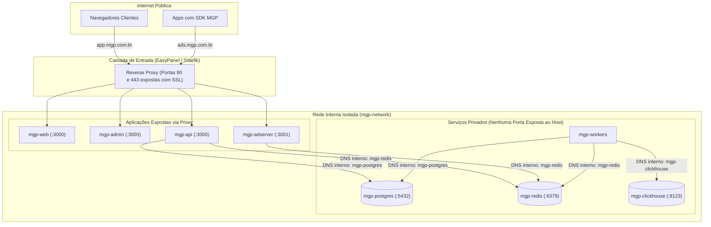

# 02. Docker, Redes Internas e Isolamento de Serviços

## 1. Topologia de Rede e Comunicação entre Containers

A segurança e estabilidade da MGP exigem uma separação nítida entre o tráfego público e a comunicação interna de persistência:

---

## 2. Princípios de Isolamento e Zero Trust

1. **Bancos de Dados Invisíveis para a Internet:**
   * Os containers `mgp-postgres`, `mgp-redis` e `mgp-clickhouse` não possuem mapeamento de portas (`ports: []`) no EasyPanel em produção.
   * Eles são acessíveis unicamente através do DNS interno da rede Docker gerenciada (`http://mgp-postgres:5432` ou `http://mgp-redis:6379`).
2. **Acesso Administrativo Seguro:**
   * Qualquer manutenção emergencial no banco deve ser feita via túnel SSH autenticado por chave pública ou através de scripts de manutenção controlados.
3. **Ambiente Local de Desenvolvimento (Docker Compose):**
   * No arquivo [`infrastructure/docker/docker-compose.yml`](file:///f:/mobile_growth/infrastructure/docker/docker-compose.yml), as portas são mapeadas para `localhost` (5432, 6379, 9000, 8123) exclusivamente para permitir que o desenvolvedor execute o código diretamente na máquina host durante o desenvolvimento local.

---

## 3. Estratégia de Build Multi-Stage

Todos os Dockerfiles adotam a arquitetura Multi-Stage:
* **Estágio `builder`:** Executa sobre `node:20-alpine`, instala dependências completas, compila TypeScript, gera cliente Prisma e remove dependências de desenvolvimento (`pnpm prune --prod`).
* **Estágio `runner`:** Utiliza imagem limpa do Alpine Linux, cria um usuário de sistema sem privilégios administrativos (`nestjs`, `nextjs`, `adserver`), copia apenas o bundle compilado em `dist/` ou `.next/standalone`, resultando em containers leves (< 150MB), rápidos para inicializar e imunes a vulnerabilidades típicas de ferramentas de desenvolvimento.
