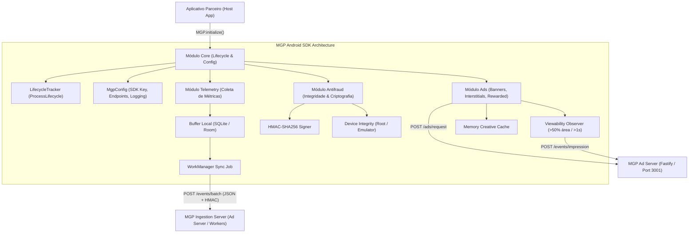
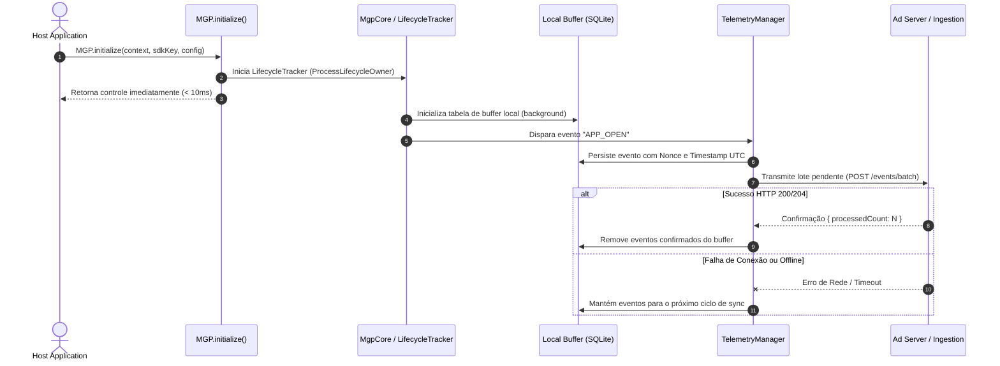

# 01. Arquitetura do SDK Android (MGP Android SDK)

Este documento estabelece a especificação técnica oficial, padrões arquiteturais, modelo de concorrência e diretrizes de engenharia para o **MGP Android SDK**. 

O SDK é a biblioteca cliente instalada nos aplicativos de desenvolvedores e publishers participantes da rede Mobile Growth Platform, com as responsabilidades centrais de:
1. **Telemetria e Métricas de Ciclo de Vida:** Coleta de abertura, sessões ativas, retenção e engajamento.
2. **Entrega de Formatos Publicitários:** Carregamento e renderização de Banners, Interstitials e Rewarded Ads.
3. **Integridade de Tráfego e Antifraude:** Assinatura criptográfica HMAC-SHA256, detecção de emuladores e validação de visibilidade (*viewability*).
4. **Segregação Ética e Google Play Compliance:** Total conformidade com a Google Play Developer Policy e LGPD (zero coleta de identificadores de hardware permanentes).

---

## 1. Requisitos Técnicos e Stack Oficial

| Componente | Requisito / Versão | Justificativa Técnica |
| :--- | :--- | :--- |
| **Linguagem Oficial** | **Kotlin 2.0+** | Segurança contra nulos (`Null-Safety`), corrotinas nativas e interoperabilidade Java. |
| **Android Gradle Plugin**| **AGP 8.3+** | Compatibilidade com R8/ProGuard moderno e otimizações de compilação. |
| **Versão Mínima (minSDK)**| **API Level 24 (Android 7.0 Nougat)** | Cobre **>96% dos dispositivos Android ativos** globalmente sem sacrificar APIs modernas de concorrência. |
| **Versão Alvo (targetSDK)**| **API Level 34 (Android 14)** | Conformidade compulsória com as exigências anuais de publicação na Google Play Store. |
| **Target Java** | **Java 17 / JVM Target 17** | Padrão LTS de compilação e execução da stack moderna Android. |
| **Tamanho Máximo do AAR**| **< 350 KB comprimido** | Impacto mínimo no APK final do publisher para garantir alta taxa de adesão. |
| **Dependências Externas** | **Mínimas e Isoladas** | Somente `kotlinx-coroutines`, `work-runtime-ktx` e bibliotecas AndroidX fundamentais. Sem frameworks pesados de injeção de dependência. |

---

## 2. Topologia Modular do SDK

O SDK adota uma arquitetura interna estritamente desacoplada em quatro subsistemas cooperantes:



### 2.1. `com.mgp.sdk.core` (Núcleo e Ciclo de Vida)
* **Ponto Único de Entrada:** Singleton estático `MGP.initialize(context, sdkKey, config)`.
* **Inicialização Não-Bloqueante:** Toda resolução pesada (detecção de hardware, inicialização de banco local) é despachada para threads de background (`Dispatchers.IO`), liberando a Thread Principal (*Main Thread*) em menos de 10 milissegundos.
* **Monitoramento Automático de Processo:** Implementa `DefaultLifecycleObserver` via `ProcessLifecycleOwner` da AndroidX para capturar transições `ON_START` (aplicativo indo para primeiro plano) e `ON_STOP` (aplicativo indo para segundo plano) sem exigir chamadas manuais do publisher em cada `Activity`.

### 2.2. `com.mgp.sdk.telemetry` (Motor de Métricas)
* **Buffer Persistente de Contingência:** Todo evento gerado é gravado primeiro em um banco SQLite leve local antes da tentativa de transmissão. Se o usuário estiver offline ou em modo avião, nenhum dado é perdido.
* **Despacho em Lote (*Batching*):** Agrupa eventos de ciclo de vida e engajamento em lotes (até 50 eventos ou a cada 60 segundos), economizando rádio celular e bateria do dispositivo do usuário.
* **Sincronização em Segundo Plano via `WorkManager`:** Em caso de acúmulo de eventos em buffer com falhas recorrentes de rede, o `WorkManager` do Android é acionado com restrição de rede ativa (`NetworkType.CONNECTED`) e *Exponential Backoff*.

### 2.3. `com.mgp.sdk.antifraud` (Segurança e Anti-Tampering)
* **Assinatura Criptográfica HMAC-SHA256:** Cada lote de telemetria e cada evento de impressão é assinado com HMAC-SHA256 combinando `timestamp + nonce + sdkKey + payloadHash`, prevenindo ataques de *Man-in-the-Middle (MitM)* e adulteração de tráfego.
* **Deduplicação por Nonce:** Geração de UUID v4 criptográfico por evento. O backend armazena o nonce no Redis com TTL de 10 minutos; qualquer tentativa de reutilizar o mesmo pacote é descartada como *Replay Attack*.
* **Inspeção Passiva de Integridade:** Checagem leve de indicadores conhecidos de emuladores (ex.: `generic`, `vbox86p`, `goldfish`, arquiteturas virtuais de processador) e flags de ambiente com *su* binário (Root). Dispositivos suspeitos recebem a flag `isEmulator = true` ou `isRooted = true` no contexto de telemetria sem travar a experiência do usuário, permitindo filtragem no leilão.

### 2.4. `com.mgp.sdk.ads` (Renderização e Formatos Publicitários)
* **Controle Estrito de Visibilidade (*Viewability Engine*):** Uma impressão publicitária só é creditada se o anúncio tiver permanecido visível com pelo menos 50% de sua área na tela por no mínimo 1 segundo contínuo, conforme padrão normativo IAB/MRC.
* **Componente de Banner (`MgpBannerView`):** Herda de `FrameLayout`, com redimensionamento responsivo, carregamento assíncrono de imagem com cache e clique tratado de forma segura.
* **Anúncios Intersticiais (`MgpInterstitialAd`):** Formato em tela cheia com pré-carregamento assíncrono (*preload*) e controle de frequência (*Frequency Capping*) configurável.
* **Anúncios Recompensados (`MgpRewardedAd`):** Formato com recompensa explícita via callback verificado `onUserEarnedReward(rewardItem)`.

---

## 3. Modelo de Concorrência e Threading

O SDK adota **Kotlin Coroutines** com isolamento estrito de responsabilidades por dispatcher:

| Dispatcher | Responsabilidade Exclusiva |
| :--- | :--- |
| **`Dispatchers.Main`** | Apenas manipulação de views Android (renderizar View do Banner, exibir Activity do Interstitial) e disparo de callbacks de eventos para o app host (`onAdLoaded`, `onAdFailedToLoad`). |
| **`Dispatchers.IO`** | Operações de entrada e saída: Leitura/escrita no buffer SQLite local, requisições HTTP para o Ad Server e leitura de arquivos de cache de criativos. |
| **`Dispatchers.Default`** | Processamento computacional intensivo: Computação de hash HMAC-SHA256, serialização/deserialização JSON de payloads e checagens heurísticas de integridade do sistema. |

---

## 4. Conformidade com Google Play e Privacidade

### 4.1. Proibição de Identificadores Permanentes
* Em estrita conformidade com a política **Google Play Developer Policy (Families & Target API)**:
  * O SDK **NÃO** lê e **NÃO** declara permissões para `READ_PHONE_STATE`, `GET_ACCOUNTS` ou acesso a hardware persistente.
  * O identificador publicitário utilizado é exclusivamente o **Google Advertising ID (AAID)** obtido via `AdvertisingIdClient`.
  * Caso o usuário ative a opção "Desativar personalização de anúncios" (*Limit Ad Tracking*), o SDK detecta o `isLimitAdTrackingEnabled = true` e zera compulsoriamente o identificador (`00000000-0000-0000-0000-000000000000`), servindo exclusivamente anúncios contextuais.

### 4.2. Permissões Declaradas no `AndroidManifest.xml`
O SDK exige o mínimo indispensável de permissões de sistema:
```xml
<manifest xmlns:android="http://schemas.android.com/apk/res/android"
    package="com.mgp.sdk">

    <!-- Obrigatória para comunicação com API e Ad Server -->
    <uses-permission android:name="android.permission.INTERNET" />
    
    <!-- Obrigatória para checagem de conectividade antes de disparar requisições -->
    <uses-permission android:name="android.permission.ACCESS_NETWORK_STATE" />
    
    <!-- Para obter o Google Advertising ID no Android 13+ (API 33+) -->
    <uses-permission android:name="com.google.android.gms.permission.AD_ID" />
</manifest>
```

---

## 5. Fluxo de Inicialização e Ciclo de Vida do Aplicativo



---

## 6. Critérios de Homologação da Arquitetura

1. **Zero Impacto no Frame Rate (60/120 FPS):** Nenhuma rotina de telemetria, criptografia ou rede pode executar na Thread Principal.
2. **Resiliência Offline:** O SDK armazena até 1.000 eventos em buffer local de forma circular (descartando os mais antigos se o limite for atingido), garantindo que o app host nunca sofra com vazamento de memória ou estouro de disco.
3. **Consistência de Tipos Monorepo:** Todos os formatos de payload do SDK espelham exatamente os contratos definidos em `packages/contracts/src/telemetry.contracts.ts`.

