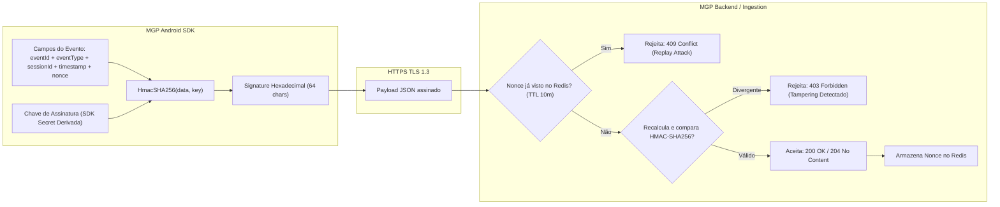
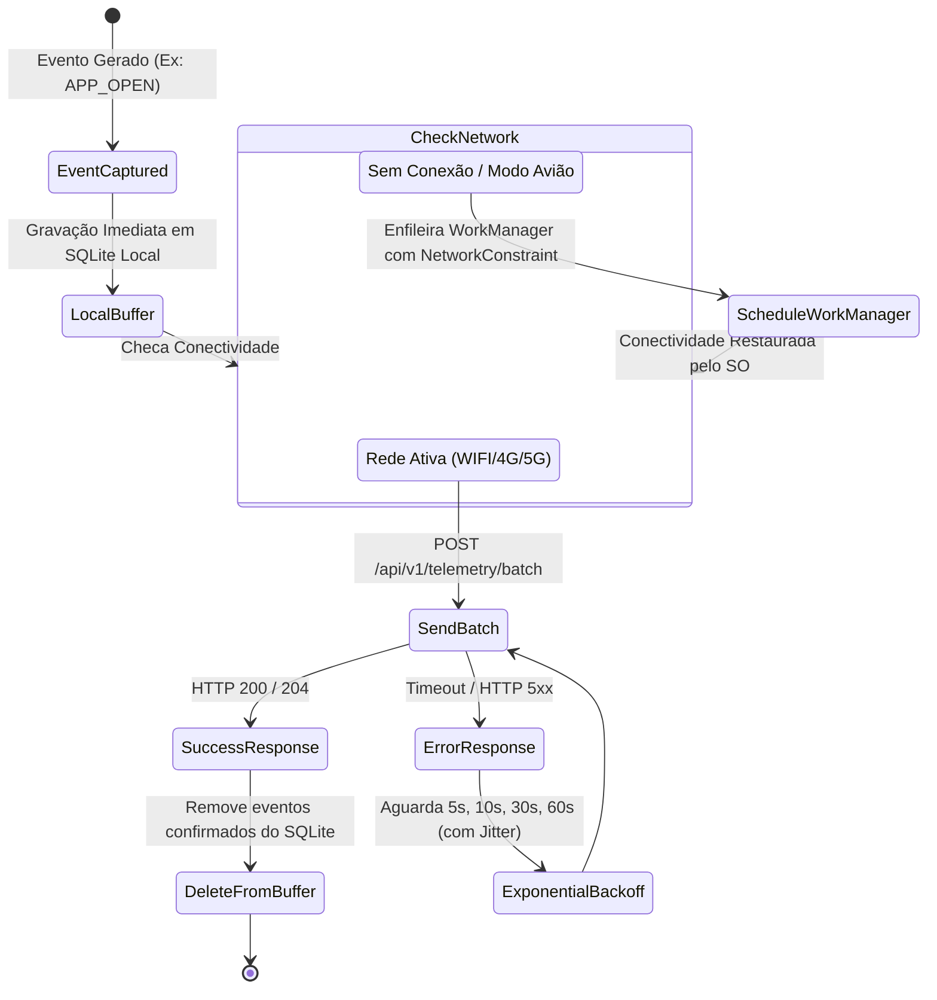

# 02. Especificação do Protocolo de Telemetria e Antifraude

Este documento define formalmente a taxonomia de eventos, formatos de payload JSON, regras de coleta, algoritmos de assinatura criptográfica HMAC-SHA256 e mecanismos de mitigação de fraude da **Mobile Growth Platform (MGP)**.

---

## 1. Taxonomia de Eventos de Telemetria

Os eventos emitidos pelo MGP Android SDK são divididos em duas categorias: **Eventos de Ciclo de Vida do Aplicativo** (gerenciados compulsoriamente pelo SDK) e **Eventos Customizados de Engajamento** (disparados explicitamente pelo desenvolvedor).

| Tipo de Evento (`eventType`) | Gatilho de Disparo | Frequência / Regra | Finalidade Analítica |
| :--- | :--- | :--- | :--- |
| **`APP_OPEN`** | Disparado na invocação de `MGP.initialize()` ou retorno de segundo plano após > 30 minutos de inatividade. | Uma vez por lançamento / reabertura a frio. | Rastreamento de DAU (Daily Active Users) e frequência de uso. |
| **`SESSION_START`** | Disparado na transição do aplicativo para o primeiro plano (`ON_START`). | A cada nova sessão ativa do usuário. | Cálculo de sessões diárias, contagem de acessos e início da contagem de tempo de tela. |
| **`HEARTBEAT`** | Disparado periodicamente enquanto o aplicativo permanecer em primeiro plano. | A cada **60 segundos** de uso ativo ininterrupto. | Medição precisa de tempo de permanência (*Time Spent / Duration*), detecção de crash silencioso e usuários simultâneos ativos (*Concurrent Users*). |
| **`SESSION_END`** | Disparado quando o aplicativo vai para segundo plano (`ON_STOP`) ou no encerramento de processo. | No final de cada sessão ativa. | Consolidação da duração total da sessão em segundos e métricas de saída. |
| **`CUSTOM_EVENT`** | Disparado manualmente via `MGP.trackEvent(eventName, properties)`. | Sob demanda do aplicativo host (máx. 20 propriedades por evento). | Rastreamento de conversões in-app, término de tutorial, compras ou transições de nível. |

---

## 2. Estrutura do Envelope de Telemetria (JSON Payload)

As transmissões entre o SDK Android e o backend ocorrem em pacotes em lote (*batches*) enviados via `POST /api/v1/telemetry/batch` (ou endpoint de ingestão analítica rápida).

### 2.1. Payload do Lote de Telemetria (`TelemetryBatchRequest`)

```json
{
  "batchId": "b1a2c3d4-e5f6-7890-abcd-ef1234567890",
  "sentAt": "2026-11-06T14:30:00.123Z",
  "sdkKey": "mgp_live_sdk_9f8e7d6c5b4a3210",
  "device": {
    "platform": "ANDROID",
    "osVersion": "14",
    "apiLevel": 34,
    "deviceModel": "Pixel 8 Pro",
    "manufacturer": "Google",
    "brand": "google",
    "screenWidth": 1344,
    "screenHeight": 2992,
    "screenDensity": 3.0,
    "locale": "pt-BR",
    "timezone": "America/Sao_Paulo",
    "advertisingId": "4a5b6c7d-8e9f-0123-4567-89abcdef0123",
    "isLimitAdTracking": false,
    "isEmulator": false,
    "isRooted": false
  },
  "app": {
    "packageName": "com.acmegames.runner3d",
    "appVersion": "2.4.1",
    "versionCode": 20401,
    "sdkVersion": "0.1.0",
    "installSource": "com.android.vending"
  },
  "network": {
    "networkType": "WIFI",
    "carrier": "Claro",
    "isVpnActive": false
  },
  "events": [
    {
      "eventId": "e9a8b7c6-d5e4-3210-fedc-ba9876543210",
      "eventType": "SESSION_START",
      "sessionId": "s1234567-89ab-cdef-0123-456789abcdef",
      "timestamp": "2026-11-06T14:29:45.000Z",
      "sequenceNumber": 1,
      "properties": {
        "entryPoint": "LAUNCHER_ICON"
      },
      "nonce": "a1b2c3d4-5678-90ab-cdef-1234567890ab",
      "signature": "e3b0c44298fc1c149afbf4c8996fb92427ae41e4649b934ca495991b7852b855"
    },
    {
      "eventId": "f8a7b6c5-d4e3-210f-edcb-a9876543210f",
      "eventType": "HEARTBEAT",
      "sessionId": "s1234567-89ab-cdef-0123-456789abcdef",
      "timestamp": "2026-11-06T14:30:45.000Z",
      "sequenceNumber": 2,
      "properties": {
        "activeDurationSeconds": 60,
        "batteryLevel": 85,
        "isBatteryCharging": true
      },
      "nonce": "b2c3d4e5-6789-01ab-cdef-234567890abc",
      "signature": "c8b4d21059f1c1a9afbf4c8996fb92427ae41e4649b934ca495991b7852b771a"
    }
  ]
}
```

---

## 3. Protocolo Criptográfico Antifraude (HMAC-SHA256)

Para impedir injeção de eventos forjados e garantir a autenticidade de origem de cada evento de telemetria, o SDK aplica o algoritmo **HMAC-SHA256**:



### 3.1. Formação da String de Assinatura
A string canônica de assinatura é montada de forma determinística:
$$\text{canonicalString} = \text{eventId} + "|" + \text{eventType} + "|" + \text{sessionId} + "|" + \text{timestamp} + "|" + \text{nonce}$$

### 3.2. Deduplicação de Nonce
* O `nonce` é um identificador único universal (UUID v4) gerado a cada novo evento.
* Ao receber o evento, o servidor consulta o Redis: `EXISTS nonce:<nonce>`.
* Se o nonce já existir, a requisição é descartada como **ataque de replay**.
* Se o nonce for inédito, o backend o grava com `SETEX nonce:<nonce> 600 "1"` (10 minutos de expiração).

---

## 4. Heurísticas de Detecção de Emuladores e Dispositivos Não-Autênticos

O módulo `com.mgp.sdk.antifraud` executa inspeções passivas no dispositivo durante a inicialização:

### 4.1. Indicadores de Emulador Android
O SDK verifica a combinação de parâmetros de compilação do Android (`android.os.Build`):
1. **`Build.FINGERPRINT`**: Presença de prefixos `generic`, `vbox86p`, `emulator`, `unknown`.
2. **`Build.HARDWARE`**: Valores correspondentes a `goldfish`, `ranchu`, `vbox86`.
3. **`Build.MANUFACTURER`**: `Genymotion`, `unknown`.
4. **`Build.PRODUCT`**: `sdk_gphone`, `google_sdk`, `vbox86p`.
5. **Arquitetura de CPU**: Presença exclusiva de x86 em dispositivos sem emulação ARM anunciada.

*Se múltiplos indicadores forem positivos, o SDK atribui `isEmulator = true`.*

### 4.2. Indicadores de Acesso Root
1. **Presença de Binários Su:** Verificação da existência de executáveis `/system/app/Superuser.apk`, `/system/xbin/su`, `/system/bin/su`, `/sbin/su`.
2. **Tags de Compilação:** `Build.TAGS != null && Build.TAGS.contains("test-keys")`.

*Se detectado, o SDK atribui `isRooted = true`.*

> [!NOTE]
> O SDK **não bloqueia o funcionamento do aplicativo do parceiro** em caso de detecção de Root ou Emulador, pois muitos usuários legítimos utilizam custom ROMs ou testadores rodam emuladores. A informação é transmitida como metadado de contexto para que o **Ad Server da MGP descarte anúncios de alto valor ou aplique pontuação de risco na decisão de leilão**.

---

## 5. Estratégia de Despacho Resiliente e Tolerância a Falhas



### 5.1. Regras de Retenção do Buffer Local
* **Capacidade Máxima:** **1.000 eventos** ou **5 MB de armazenamento**.
* **Política de Descarte (FIFO):** Caso o aplicativo permaneça offline por dias e o limite de 1.000 eventos seja atingido, os eventos mais antigos são descartados em favor dos mais recentes, priorizando a integridade de dados recentes.
* **Tamanho de Lote Ótimo:** Mínimo de 1 evento (no encerramento do app) e máximo de 50 eventos por pacote HTTP para garantir transmissão rápida em redes instáveis.

