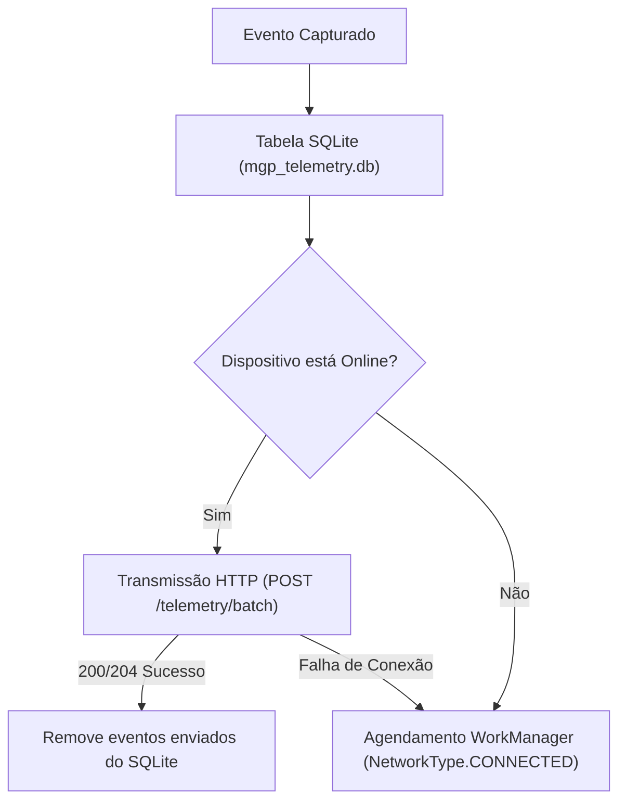

# 03. Guia de Implementação e Integração do MGP Android SDK

Este documento é a referência normativa para desenvolvedores parceiros e engenheiros da **Mobile Growth Platform (MGP)**, descrevendo passo a passo como integrar, inicializar, testar e publicar aplicativos Android contendo o **MGP Android SDK (Kotlin)**.

---

## 1. Instalação e Dependências no Gradle

O SDK é distribuído no formato Android Archive (AAR) otimizado e modularizado.

### 1.1. Adicionar Repositório no `settings.gradle.kts`
```kotlin
dependencyResolutionManagement {
    repositoriesMode.set(RepositoriesMode.FAIL_ON_PROJECT_REPOS)
    repositories {
        google()
        mavenCentral()
        maven { url = java.net.URI("https://repo.mgp.com.br/maven") }
    }
}
```

### 1.2. Declarar Dependência no `app/build.gradle.kts`
```kotlin
android {
    defaultConfig {
        minSdk = 24 // Android 7.0 (Nougat) ou superior
        targetSdk = 34 // Android 14
    }
    compileOptions {
        sourceCompatibility = JavaVersion.VERSION_17
        targetCompatibility = JavaVersion.VERSION_17
    }
    kotlinOptions {
        jvmTarget = "17"
    }
}

dependencies {
    implementation("com.mgp.sdk:mgp-sdk:0.1.0")
    
    // Dependências transitivas AndroidX
    implementation("androidx.lifecycle:lifecycle-process:2.8.4")
    implementation("androidx.work:work-runtime-ktx:2.9.1")
}
```

---

## 2. Permissões no `AndroidManifest.xml`

O SDK já declara suas permissões mínimas no manifesto interno (com fusão automática no build do host):

```xml
<manifest xmlns:android="http://schemas.android.com/apk/res/android"
    package="com.seupacote.app">

    <!-- Conexão com endpoints de telemetria e leilão de anúncios -->
    <uses-permission android:name="android.permission.INTERNET" />

    <!-- Monitoramento do estado da rede para o buffer offline SQLite -->
    <uses-permission android:name="android.permission.ACCESS_NETWORK_STATE" />

    <!-- Permissão para leitura do Google Advertising ID no Android 13+ (API 33+) -->
    <uses-permission android:name="com.google.android.gms.permission.AD_ID" />

</manifest>
```

> [!IMPORTANT]
> O SDK **NÃO** declara e **NÃO** exige permissões invasivas de privacidade (como `READ_PHONE_STATE`, `ACCESS_FINE_LOCATION` ou identificadores de hardware). O aplicativo mantém 100% de conformidade com a seção *Data Safety* da Google Play Store.

---

## 3. Inicialização Não-Bloqueante (`MGP.initialize`)

A inicialização deve ser feita na classe `Application` do host no método `onCreate()`. O SDK é não-bloqueante e libera a thread principal em menos de 10 milissegundos:

```kotlin
package com.seupacote.app

import android.app.Application
import com.mgp.sdk.MGP
import com.mgp.sdk.MgpConfig

class MainApplication : Application() {

    override fun onCreate() {
        super.onCreate()

        val config = MgpConfig.Builder("mgp_live_sdk_chave_gerada_no_painel")
            .setDebugMode(BuildConfig.DEBUG) // Logs detalhados apenas em compilações de teste
            .setAutoCollectLifecycle(true)   // Coleta automática de APP_OPEN, SESSION_START e HEARTBEAT
            .setHeartbeatInterval(60L)       // Pulso de retenção a cada 60 segundos
            .build()

        MGP.initialize(this, config)
    }
}
```

---

## 4. Rastreamento Automático e Eventos Customizados

### 4.1. Ciclo de Vida Automático
Quando `autoCollectLifecycle = true`:
1. **`APP_OPEN`:** Emitido automaticamente no lançamento a frio do aplicativo.
2. **`SESSION_START`:** Disparado pelo `ProcessLifecycleOwner` no evento `ON_START` (app em primeiro plano).
3. **`HEARTBEAT`:** Pulso periódico automático emitido a cada 60 segundos com o tempo de tela acumulado (`activeDurationSeconds`).
4. **`SESSION_END`:** Emitido no evento `ON_STOP` (app enviado para segundo plano).

### 4.2. Disparo de Eventos Customizados in-app
Para rastrear conversões de marketing, conclusão de fases ou compras:

```kotlin
// Exemplo 1: Conversão de Tutorial
MGP.trackEvent("tutorial_completed", mapOf(
    "step" to 5,
    "duration_seconds" to 120
))

// Exemplo 2: Compra In-App Realizada
MGP.trackEvent("in_app_purchase", mapOf(
    "item_sku" to "coins_pack_500",
    "currency" to "BRL",
    "value" to 19.90
))
```

### 4.3. Forçar Sincronização Imediata (`flush`)
Para garantir o envio antes de encerramentos iminentes:
```kotlin
MGP.flush()
```

---

## 5. Arquitetura de Buffer Offline e Sincronização



* **Capacidade Máxima do Buffer:** 1.000 eventos ou 5 MB.
* **Política de Descarte (FIFO):** Ao atingir 1.000 eventos em modo offline contínuo, os 100 eventos mais antigos são descartados em favor dos novos, impedindo impacto de armazenamento no aparelho.

---

## 6. Configuração do ProGuard / R8 (`consumer-rules.pro`)

As regras ProGuard são aplicadas automaticamente através do AAR:

```proguard
-keep public class com.mgp.sdk.MGP { *; }
-keep public class com.mgp.sdk.MgpConfig { *; }
-keep public class com.mgp.sdk.ads.** { *; }
-keep class com.mgp.sdk.telemetry.** { *; }
-keepattributes *Annotation*
-dontwarn com.google.android.gms.ads.identifier.**
```

---

## 7. Critérios de Homologação da Fase 18

1. **Assinatura HMAC-SHA256:** Todos os eventos possuem hash de integridade de 64 caracteres hexadecimais combinando `eventId|eventType|sessionId|timestamp|nonce` com a chave SDK.
2. **Deduplicação de Nonce:** Cada evento possui um UUID v4 único para rejeição de ataques de repetição.
3. **Resiliência a Falhas:** Ausência de exceções não tratadas (*zero crashes*) mesmo com rede desconectada, modo avião ou instabilidades no servidor.
4. **Respeito à Privacidade:** Se o usuário ativar o *Limit Ad Tracking*, o `advertisingId` é transmitido zerado (`00000000-0000-0000-0000-000000000000`).

