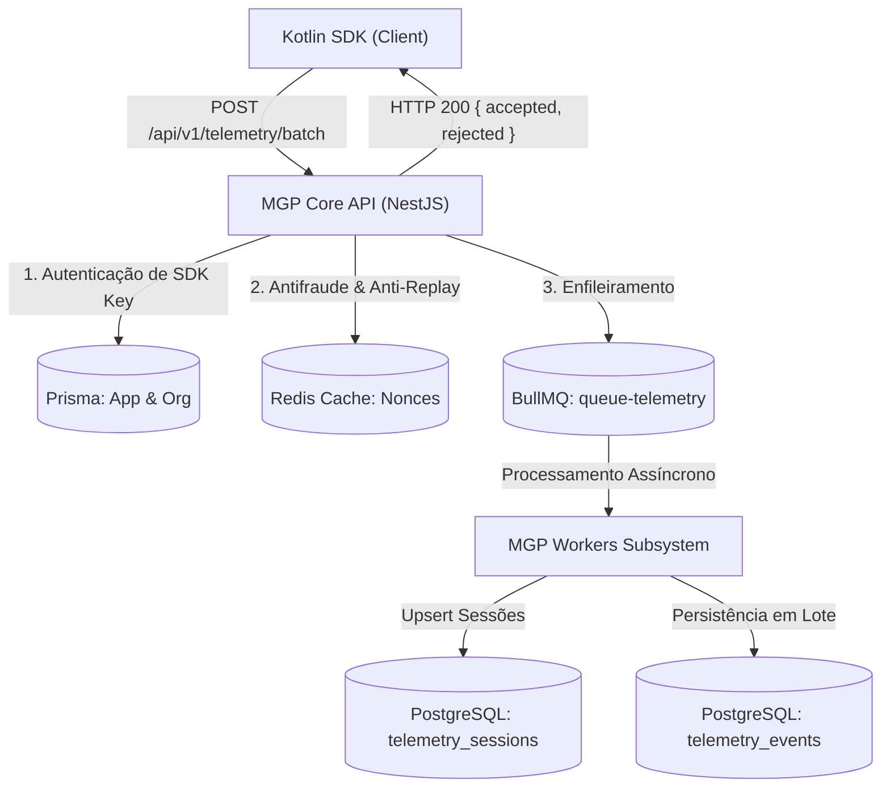

# MGP Telemetry Engine, Ingestion & Antifraud (Fase 19)

Este documento descreve a especificação técnica e a arquitetura do motor de ingestão de telemetria, ciclo de vida de sessões, persistência analítica e defesas criptográficas/antifraude implementadas no backend do Mobile Growth Platform (MGP).

---

## 1. Visão Geral da Arquitetura

O subsistema de telemetria do backend é desenhado para ingestão em larga escala com desacoplamento assíncrono:



### Características Centrais:
- **Zero-Block Ingestion:** A API executa a validação criptográfica e de integridade em memória e Redis, despachando o processamento pesado e I/O para a fila BullMQ `queue-telemetry`.
- **Atomicidade e Resiliência:** Caso a conexão com Redis ou BullMQ sofra instabilidade temporária, o subsistema possui fallbacks defensivos em memória (`in-memory LRU nonce cache` e fallback de fila).
- **Isolamento Multi-Tenant:** Toda sessão e evento persistido é estritamente associado ao `appId` e `organizationId` resolvidos a partir da SDK Key da aplicação.

---

## 2. Camada Criptográfica e Prevenção Anti-Replay

### 2.1 Formato Canônico e HMAC-SHA256
Cada evento individual é assinado pelo SDK com a SDK Key da aplicação:
$$\text{CanonicalString} = \text{eventId} \mathbin{\Vert} \text{eventType} \mathbin{\Vert} \text{sessionId} \mathbin{\Vert} \text{timestamp} \mathbin{\Vert} \text{nonce}$$

O backend recomputa o HMAC-SHA256:
```typescript
const computedHmac = crypto.createHmac('sha256', sdkKey).update(canonicalString).digest('hex');
```
A verificação utiliza `crypto.timingSafeEqual` para imunidade completa a ataques de canal lateral baseados em tempo (*timing attacks*).

### 2.2 Controle de Timestamp Drift
Para mitigar spoofing temporal e adulteração de relógio do dispositivo:
- Eventos com timestamp anterior a **24 horas** no passado são descartados (`TIMESTAMP_TOO_OLD`).
- Eventos com timestamp superior a **5 minutos** no futuro são descartados (`TIMESTAMP_IN_FUTURE`).

### 2.3 Prevenção de Ataques de Replay (Nonce Deduplication)
- Cada evento carrega um `nonce` único (UUID v4).
- O backend consulta o Redis com comando atômico `SET nonce:telemetry:{nonce} 1 EX 600 NX`.
- Se a chave já existir, o evento é rejeitado com a razão `NONCE_ALREADY_USED`.
- O tempo de vida (TTL) de 600 segundos (10 minutos) cobre amplamente qualquer janela de repetição de pacotes na rede.

---

## 3. Motor de Antifraude e Integridade de Dispositivo

O `TelemetryAntifraudService` inspeciona os sinais de integridade reportados pelo hardware e ambiente:

| Sinal Detectado | Regra / Indicador | Ação no Backend |
|---|---|---|
| **Ambiente Emulador** | `isEmulator: true` (QEMU, Goldfish, Build.FINGERPRINT) | Marcado com `isFraudulent: true`, razão `EMULATOR_ENVIRONMENT`. Dados são persistidos para auditoria, mas expurgados de métricas orgânicas. |
| **Acesso Root / Jailbreak** | `isRooted: true` (`su` binary, Magisk, Test-Keys) | Marcado com `isFraudulent: true`, razão `ROOTED_DEVICE`. |
| **Limit Ad Tracking (LAT)** | `isLimitAdTracking: true` | O campo `advertisingId` é limpo/ignorado, em total conformidade com a LGPD e Google Play Developer Policies. |
| **Identificadores Proibidos** | IMEI, MAC, ANDROID_ID | **Zero persistência**. Nenhuma coluna na modelagem relacional armazena identificadores de hardware permanentes. |

---

## 4. Modelagem de Dados Relacional (PostgreSQL / Prisma)

### 4.1 Tabela `telemetry_sessions`
Rastreia o ciclo de vida completo da sessão do usuário:
- `id`: UUID (Primary Key).
- `sessionId`: String única indexada gerada pelo SDK.
- `appId` & `organizationId`: Foreign Keys com integridade referencial.
- `startedAt`: Timestamp do primeiro evento ou `SESSION_START`.
- `endedAt`: Timestamp de encerramento (`SESSION_END`).
- `durationSeconds`: Duração consolidada atualizada por `HEARTBEAT` ou `SESSION_END`.
- `lastHeartbeatAt`: Última pulsação recebida.
- Metadados de dispositivo: `deviceModel`, `osVersion`, `locale`, `timezone`, `networkType`, `carrier`, `ipAddress`.
- Indicadores de integridade: `isEmulator`, `isRooted`, `advertisingId`, `isLimitAdTracking`.

### 4.2 Tabela `telemetry_events`
Tabela analítica imutável que registra cada evento individual:
- `id`: UUID (Primary Key).
- `eventId`: UUID único originário do cliente (Indexado).
- `sessionId`: Chave da sessão de telemetria.
- `appId` & `organizationId`: Particionamento lógico multi-tenant.
- `eventType`: Enum textual (`APP_OPEN`, `SESSION_START`, `HEARTBEAT`, `SESSION_END`, `CUSTOM_EVENT`).
- `sequenceNumber`: Contador incremental para reordenação de eventos fora de ordem.
- `properties`: Objeto JSON estruturado para atributos customizados.
- `timestamp`: Timestamp exato da ocorrência no cliente.
- `nonce`: UUID v4 anti-replay.
- `signature`: Hash HMAC-SHA256 validado.
- `isFraudulent`: Booleano identificador de anomalias/fraude.
- `fraudReason`: Justificativa analítica (`EMULATOR_ENVIRONMENT`, `ROOTED_DEVICE`).

---

## 5. Endpoints REST da API

### `POST /api/v1/telemetry/batch`
- **Acesso:** Público (Autenticado por cabeçalho `x-mgp-sdk-key` ou campo `appId`).
- **Headers:** `x-mgp-sdk-key: mgp_live_...`
- **Request Body:** `TelemetryBatchDto` (validado via Zod / `TelemetryBatchSchema`).
- **Response:**
  ```json
  {
    "batchId": "a933f2e0-24e5-4f33-8a30-88095f32a762",
    "accepted": 12,
    "rejected": 0,
    "reasons": []
  }
  ```

### `GET /api/v1/telemetry/metrics`
- **Acesso:** Restrito (Bearer Token JWT - NOC / Admin).
- **Response:**
  ```json
  {
    "batchesReceived": 1500,
    "eventsAccepted": 18000,
    "eventsRejected": 15,
    "rejectionsByReason": {
      "INVALID_SIGNATURE": 5,
      "NONCE_ALREADY_USED": 10
    },
    "fraudSignalsDetected": {
      "EMULATOR_ENVIRONMENT": 42,
      "ROOTED_DEVICE": 8
    },
    "activeIngestionQueues": {
      "waiting": 3,
      "active": 1,
      "completed": 1496
    }
  }
  ```

