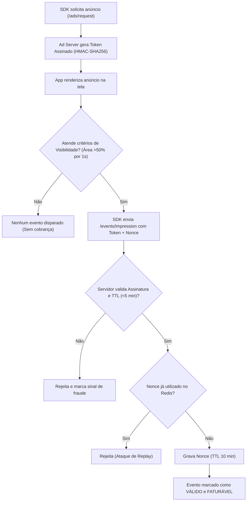

# 07. Segurança, Prevenção a Fraude e Conformidade com a Google Play

## 1. Arquitetura de Autenticação e Gestão de Identidade

A segurança da plataforma MGP segue os padrões do **OWASP Top 10** e boas práticas de proteção de APIs distribuídas:

### 1.1. Tokens JWT com Rotação Obrigatória (Refresh Token Rotation)
* **Access Token:**
  * Algoritmo: `RS256` ou `HS256` com chave de alta entropia.
  * Tempo de expiração (TTL): **15 minutos**.
  * Conteúdo mínimo no payload: `sub` (User ID), `email`, `activeOrgId`, `role`.
* **Refresh Token:**
  * Tempo de expiração (TTL): **7 dias**.
  * Armazenamento: Tabela `sessions` no PostgreSQL com hash SHA-256 do token e rastreamento de IP/User-Agent.
  * **Mecanismo de Família de Tokens (Detecção de Roubo):** Cada uso do refresh token invalida o anterior e emite um novo. Se um refresh token já consumido for apresentado novamente, toda a árvore/família de sessões daquele usuário é imediatamente revogada por suspeita de interceptação.

### 1.2. Hash de Credenciais
* Utilização estrita de **Argon2id** (ou Bcrypt com custo >= 12).
* Nenhuma senha em texto puro trafega desprotegida ou é gravada em logs.

### 1.3. Rate Limiting Baseado em Janela Deslizante (Redis)
* **Rotas de Autenticação (`/auth/login`, `/auth/register`):** Máximo de 5 tentativas por minuto por IP antes de acionar bloqueio temporário.
* **Rotas do Dashboard (`/api/v1/*`):** Máximo de 120 requisições por minuto por organização.
* **Rotas de Telemetria do SDK (`/events/*`):** Rate limit dinâmico por `app_id` e identificador de dispositivo.

---

## 2. Camada Antifraude da Ad Network

Fraudes de tráfego (cliques falsos, impressões fantasmas geradas por bots e emuladores em background) destroem o ecossistema publicitário e a confiança dos anunciantes. A MGP implementa validações nativas:

### 2.1. Critérios de Contabilização de Impressão (Viewability)
* Uma resposta HTTP `200 OK` do servidor de anúncios **não constitui uma impressão**.
* A impressão só é faturável quando o SDK móvel confirma que o anúncio esteve na tela visível do usuário por no mínimo 1 segundo com pelo menos 50% de área exibida.

### 2.2. Algoritmos de Detecção de Anomalias (Worker Antifraude)
1. **Taxa de Cliques Anormal (CTR Anômalo):** Alerta instantâneo para Ad Units com CTR superior a 8% em banners padrão ou 25% em nativos.
2. **Cluster de IPs e Geometria Impossível:** Múltiplas requisições originadas do mesmo IP para milhares de supostos dispositivos em poucos segundos.
3. **Quarentena Financeira:** Os ganhos financeiros de publishers (`PUBLISHER_EARNINGS`) ficam em status `PENDING_REVIEW` por 7 dias antes de serem liberados para saque, permitindo a depuração de tráfego inválido (IVT).

---

## 3. Conformidade com LGPD e Políticas do Google Play

### 3.1. Proibição de Identificadores Permanentes
* O SDK **jamais coleta, transmite ou armazena IMEI, MAC Address ou `ANDROID_ID`**. O Google Play proíbe terminantemente vincular dados publicitários a identificadores permanentes de hardware.
* Uso exclusivo do **Google Advertising ID (AAID)**. Se o usuário desativar a personalização de anúncios no Android, o SDK respeita o ID zerado (`00000000-0000-0000-0000-000000000000`) e exibe apenas campanhas contextuais sem rastreamento comportamental.

### 3.2. Descontinuação do Privacy Sandbox
* Conforme documentado oficialmente pela Google, iniciativas que dependiam compulsoriamente das APIs iniciais de tópicos do Privacy Sandbox foram readequadas. A MGP opera com **atribuição direta baseada em Google Play Install Referrer API**, tokens assinados de clique e modelagem estatística agregada.

### 3.3. Direitos do Titular (LGPD)
* Endpoints automatizados para exportação e exclusão definitiva de dados pessoais mediante requisição do usuário final (`/api/v1/privacy/delete-request`).

