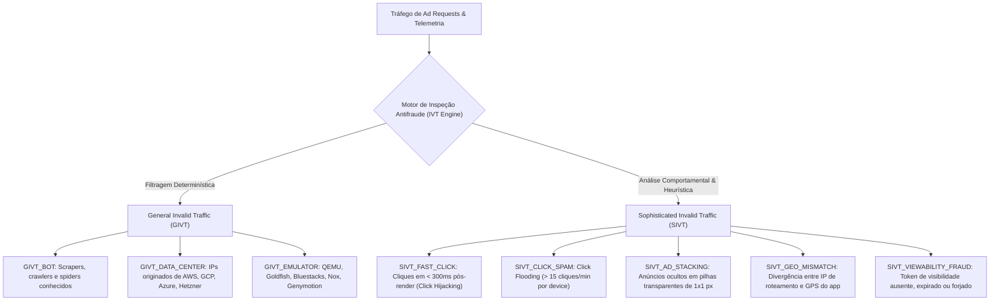
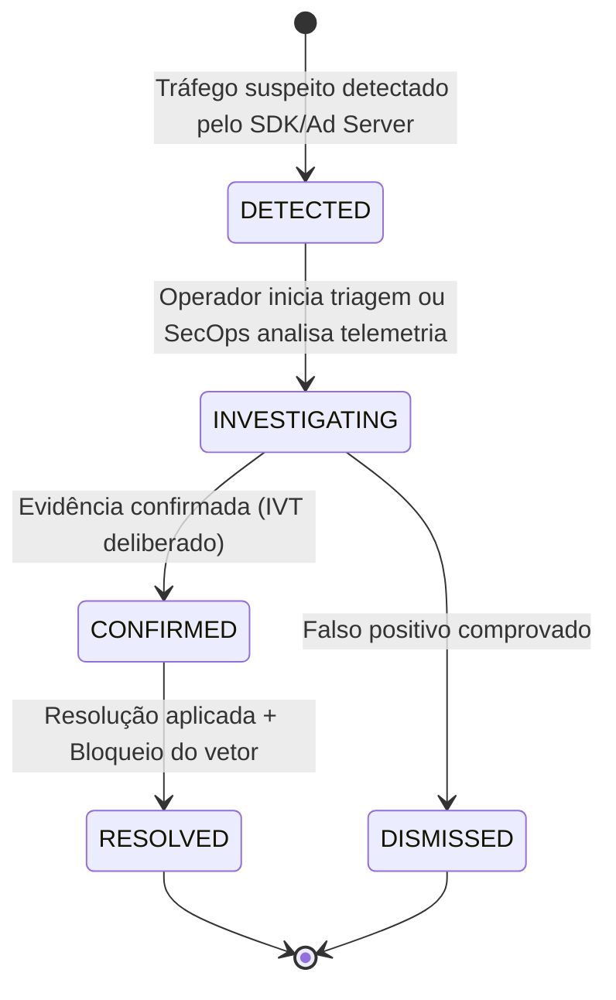

# 08. Detecção de Tráfego Inválido (IVT) e Painel de Controle de Fraudes

A plataforma **Mobile Growth Platform (MGP)** implementa uma camada abrangente de prevenção e mitigação de tráfego inválido (**Invalid Traffic - IVT**) em estrita conformidade com os padrões e diretrizes da **IAB Tech Lab** e do **Media Rating Council (MRC)**.

Este documento detalha a arquitetura de detecção, categorização (GIVT vs. SIVT), ciclo de vida dos incidentes forenses, fluxo de estorno financeiro automatizado (*fraud chargeback*) no ledger de dupla entrada e as interfaces do sistema.

---

## 1. Categorização de Tráfego Inválido (GIVT vs. SIVT)

O MRC classifica o tráfego inválido em dois domínios operacionais fundamentais:

### 1.1. General Invalid Traffic (GIVT)
Caracterizado por tráfego gerado por entidades automatizadas ou ambientes não humanos identificáveis por listas de controle e assinaturas estáticas:
* **`GIVT_BOT`**: Identificação por strings de User-Agent robóticas conhecidas ou falta de headers padrão de browsers/webview móveis.
* **`GIVT_DATA_CENTER`**: Requisições de impressão ou clique com IPs de provedores de hospedagem em nuvem (ASN de data center sem presença de usuários residenciais/móveis).
* **`GIVT_EMULATOR`**: Assinaturas de hardware emulado do Android (ex: `ro.hardware=goldfish`, build fingerprints contendo `generic`, arquiteturas virtuais de sandbox).

### 1.2. Sophisticated Invalid Traffic (SIVT)
Requer análise heurística, telemetria cruzada e machine learning para detecção de fraudes com incentivo financeiro:
* **`SIVT_FAST_CLICK`**: O tempo decorrido entre a renderização visual do criativo e o clique (`clickDeltaMs`) é inferior a **300 milissegundos**, impossibilitando reação motora humana voluntária (indício de injeção de clique ou interceptação de toque).
* **`SIVT_CLICK_SPAM`**: Dispositivos enviando volumes anormais de cliques concorrentes (> 15 cliques por minuto) para saturar a atribuição de *last-click*.
* **`SIVT_AD_STACKING`**: Múltiplas ad units empilhadas na mesma coordenada de tela em camadas Z invisíveis com opacidade zero.
* **`SIVT_GEO_MISMATCH`**: Discrepância severa entre a geolocalização do IP da conexão e a célula de dados do aparelho reportada pelo SDK.
* **`SIVT_VIEWABILITY_FRAUD`**: Impressões registradas sem o token criptográfico assinado HMAC pelo Ad Server que atesta conformidade com a norma MRC (>= 50% dos pixels na viewport por >= 1s contínuo).

---

## 2. Ciclo de Vida do Incidente Forense e Chargeback

Todos os eventos com pontuação de anomalia acima do limiar de segurança geram registros persistentes na entidade `FraudIncident` no banco de dados com isolamento multi-tenant estrito:

### 2.1. Execução Atômica de Estorno Financeiro (*Fraud Chargeback*)
Quando um incidente confirmado é resolvido com a opção `executeChargeback: true`:
1. Uma transação isolada de banco de dados (`Prisma.$transaction`) é iniciada.
2. O saldo da carteira de anunciante da organização (`WalletAccount` do tipo `ADVERTISING_CREDITS`) é incrementado com o valor de `impactAmount`.
3. É gerado um lançamento no razão financeiro (`WalletLedger`) com:
   * Tipo: `LedgerTransactionType.FRAUD_CHARGEBACK`.
   * Valor: `amount = incident.impactAmount`.
   * Idempotência garantida: `idempotencyKey = "chargeback_" + incident.id`.
   * Metadados: IDs do incidente, aplicativo, campanha e categoria IVT.
4. É emitido um registro de auditoria imutável (`AuditLog`) contendo o autor da resolução, justificativa técnica e histórico `diffBefore` / `diffAfter`.

---

## 3. Endpoints da API REST (`/api/v1/antifraud`)

| Método | Rota | Descrição | Permissão |
|---|---|---|---|
| `GET` | `/api/v1/antifraud/metrics` | Consolida taxa de IVT geral, capital protegido (R$), divisão GIVT vs. SIVT e principais vetores | `VIEW_ANALYTICS` |
| `GET` | `/api/v1/antifraud/incidents` | Listagem paginada de incidentes com filtros de status, categoria, severidade e busca | `VIEW_CAMPAIGNS` |
| `GET` | `/api/v1/antifraud/incidents/:id` | Detalhes forenses completos de um incidente específico e evidências associadas | `VIEW_CAMPAIGNS` |
| `POST` | `/api/v1/antifraud/incidents/:id/resolve` | Resolução do incidente com opção de estorno financeiro atômico | `MANAGE_CAMPAIGNS` |
| `POST` | `/api/v1/antifraud/simulate-inspection` | Simulador interativo de inspeção de tráfego para testes e auditoria | `MANAGE_CAMPAIGNS` |

---

## 4. Benchmark e Indicadores de Conformidade

De acordo com as normas da IAB/MRC para o ecossistema programático:
* **Taxa de IVT Saudável:** `< 2.0%` do volume total de tráfego.
* **Taxa em Atenção:** `2.0% - 5.0%`.
* **Taxa Crítica:** `> 5.0%` (Gera alerta operacional e paralisação automática de inventário não confiável).

O painel de controle do MGP exibe em tempo real o status comparativo contra a meta de 2.0%, permitindo ações preventivas imediatas.

